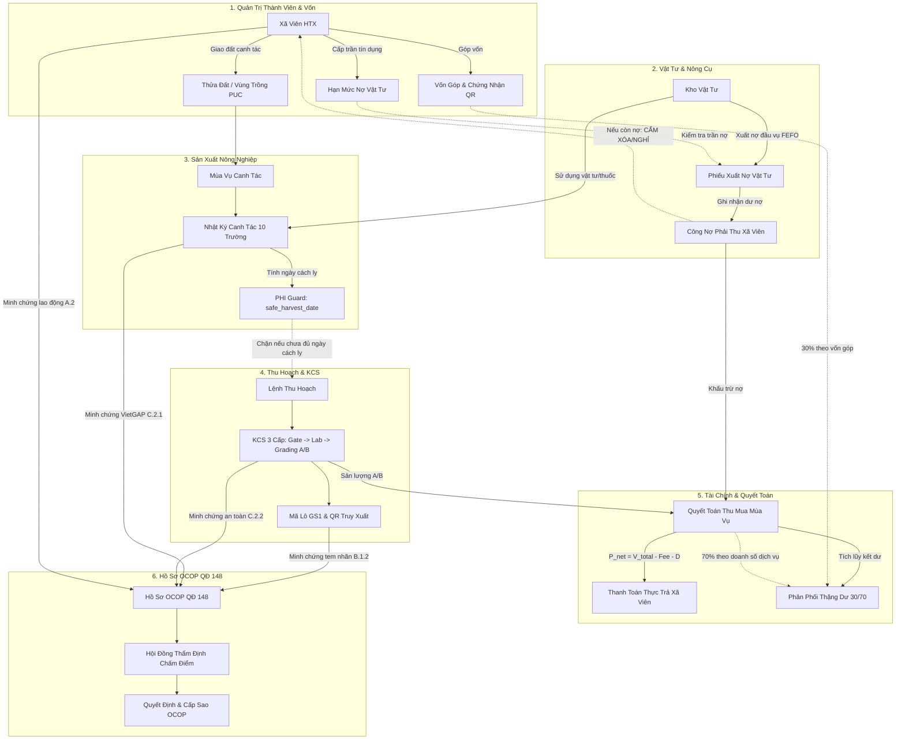

# ĐẶC TẢ TOÀN DIỆN HỆ THỐNG QUẢN TRỊ HTX NÔNG NGHIỆP & SỐ HÓA OCOP
## Báo Cáo Khảo Sát Nghiệp Vụ, Mối Quan Hệ Liên Kết, Kiểm Toán Giao Diện & Kế Hoạch Cải Tiến

> **Dự án:** Hệ thống Quản trị Hợp tác xã Nông nghiệp & Số hóa Hồ sơ Đánh giá Phân hạng OCOP  
> **Mô hình nghiên cứu thực tế:** Hợp tác xã Nông nghiệp Tân Tiến, Đà Lạt, Lâm Đồng  
> **Sản phẩm chủ lực OCOP:** Ớt chuông Sweet Palermo Đỏ Đà Lạt (Mục tiêu 4–5 sao theo QĐ 148/QĐ-TTg)  
> **Tài liệu tham chiếu:** Bộ tài liệu `docs/00–35`, Luật Hợp tác xã 2023, Quyết định 148/QĐ-TTg, Thông tư 02/2024/TT-BNNPTNT  
> **Kỹ năng áp dụng:** `spec-driven-planning`, `domain-driven-ui-spec`, `modern-ui-design`

---

## MỤC LỤC
1. [Tổng Quan Trạng Thái Xử Lý Hiện Tại của Dự Án](#1-tổng-quan-trạng-thái-xử-lý-hiện-tại-của-dự-án)
2. [Mối Quan Hệ Liên Kết Chặt Chẽ Giữa Các Phân Hệ](#2-mối-quan-hệ-liên-kết-chặt-chẽ-giữa-các-phân-hệ)
3. [Quy Trình Hoạt Động Tổng Thể Theo Vòng Đời Nghiệp Vụ](#3-quy-trình-hoạt-động-tổng-thể-theo-vòng-đời-nghiệp-vụ)
4. [Kiểm Toán Giao Diện Hiện Tại (UI Audit theo Domain-Driven UI Spec)](#4-kiểm-toán-giao-diện-hiện-tại-ui-audit-theo-domain-driven-ui-spec)
   - 4.2. [Đánh Giá Chi Tiết 12 Bảng Dữ Liệu Còn Thiếu Cần Bổ Sung Ngay](#42-đánh-giá-chi-tiết-các-giao-diện--bảng-dữ-liệu-còn-thiếu-cần-bổ-sung-ngay)
   - 4.3. [Kiểm Toán Chi Tiết 5 Tác Vụ: Thêm - Sửa - Xóa - Chi Tiết - Xuất Đồ](#43-kiểm-toán-chi-tiết-5-tác-vụ-crud--xuất-chứng-từ-thêm---sửa---xóa---chi-tiết---xuất-đồ)
5. [Kiểm Tra Nút Điều Hướng & Cấu Trúc Menu (Navigation Audit)](#5-kiểm-tra-nút-điều-hướng--cấu-trúc-menu-navigation-audit)
6. [Chuẩn Hóa Câu Từ & Thuật Ngữ Giao Diện (UX Copywriting)](#6-chuẩn-hóa-câu-từ--thuật-ngữ-giao-diện-ux-copywriting)
7. [Kế Hoạch Cải Tiến Chi Tiết Từng Giai Đoạn (Roadmap)](#7-kế-hoạch-cải-tiến-chi-tiết-từng-giai-đoạn-roadmap)

---

## 1. TỔNG QUAN TRẠNG THÁI XỬ LÝ HIỆN TẠI CỦA DỰ ÁN

### 1.1 Backend (Laravel 11 — Modular Monolith / DDD)
Backend đã được xây dựng theo chuẩn Kiến trúc 4 tầng (Domain, Application, Infrastructure, Presentation) với **9 Modules nghiệp vụ chính**:
- **Identity (`Modules\Identity`)**: Xác thực Sanctum Bearer token, Quản lý tài khoản, Phân quyền RBAC, Ma trận quyền, Cấu hình hệ thống.
- **Cooperative (`Modules\Cooperative`)**: Hồ sơ pháp lý HTX, Xã viên (FSM 5 trạng thái), Quản lý vốn góp đa hình thức (tiền mặt, chuyển khoản, quyền sử dụng đất), Sinh giấy chứng nhận vốn góp có mã QR xác thực.
- **Agriculture (`Modules\Agriculture`)**: Đơn vị sản xuất, Vùng trồng (Mã PUC), Thửa đất, Mùa vụ, Nhật ký canh tác (10 trường TT02/2024), Động cơ tính thời gian cách ly thuốc BVTV (PHI Guard), Thu hoạch KCS 3 cấp, Cấp mã lô hàng chuẩn GS1 (`LOT-[Coop]-[Plot]-[YYYYMMDD]-[Seq]`).
- **Product (`Modules\Product`)**: Quản lý danh mục sản phẩm OCOP, liên kết Lô thu hoạch vào sản phẩm.
- **Inventory (`Modules\Inventory`)**: Danh mục vật tư (phân bón, BVTV sinh học, bao bì, nông cụ), Quản lý lô hạn sử dụng (Batch/Expiry), Phiếu nhập kho KCS, Phiếu xuất kho theo nguyên tắc **FEFO/FIFO**, Cơ chế **Credit Advance** (xuất nợ đầu vụ theo trần tín dụng).
- **Finance (`Modules\Finance`)**: Sổ quỹ thu chi tiền mặt/ngân hàng, Công nợ phải thu/phải trả, Thuật toán quyết toán mùa vụ cấn trừ công nợ vật tư (`D = min(D_debt, V_total - Fee)`), Kế hoạch phân phối thặng dư cuối năm theo **nguyên tắc 30/70**.
- **OCOP (`Modules\Ocop`)**: 
  - `Criteria`: Động cơ bộ tiêu chí linh hoạt theo QĐ 148 (Nhóm $\rightarrow$ Tiêu chí $\rightarrow$ Chỉ tiêu), quản lý phiên bản (Versioning) không hard-code.
  - `Dossier`: Hồ sơ đăng ký OCOP, Bảng tự đánh giá điểm số của HTX.
  - `Evidence`: Kho minh chứng số, liên kết minh chứng với chỉ tiêu, trích xuất minh chứng tự động từ dữ liệu canh tác/thu mua.
  - `Evaluation`: Phiên chấm điểm Hội đồng thẩm định (Blind scoring độc lập), Tổng hợp điểm, Quyết định phân hạng sao (3–5 sao) và Giấy chứng nhận.
- **Audit (`Modules\Audit`)**: Ghi log vết thay đổi dữ liệu theo cơ chế **Hash Chaining SHA-256** chống sửa đổi lịch sử.
- **Report (`Modules\Report`)**: API Dashboard, Xuất biểu mẫu OCOP (Mẫu 1, 2, 3 Phụ lục II QĐ 148), Giấy chứng nhận và Báo cáo tổng hợp.

### 1.2 Frontend (React 18 + Vite + TypeScript + TailwindCSS 3.4)
- Áp dụng cấu trúc thư mục Feature-based (`src/features/*`), Router phân quyền (`ProtectedRoute`, `GuestRoute`), Quản lý state bằng TanStack Query v5 và Zustand custom stores.
- Giao diện có tính thẩm mỹ cao (màu chủ đạo Nông nghiệp Xanh Emerald `#053725` và `#0d6b46`).
- **Hạn chế hiện tại của Frontend:**
  - Một số trang phát triển ở mức prototype sử dụng mock data cục bộ (ví dụ: `ProductsPage.tsx`, `FinancePage.tsx` chưa liên kết đầy đủ API công nợ và quyết toán).
  - Có sự phân mảnh giữa các trang con: ví dụ `MembersPage.tsx` có các tab nội bộ (`capital`, `profit`) trong khi router cũng có các trang độc lập (`CapitalPage.tsx`, `ProfitPage.tsx`).
  - Menu Sidebar chưa liên kết hết các trang OCOP nâng cao (như Tiêu chí, Hội đồng chấm điểm, Quyết định).

---

## 2. MỐI QUAN HỆ LIÊN KẾT CHẶT CHẼ GIỮA CÁC PHÂN HỆ

Hệ thống HTX-OCOP không phải là các chức năng rời rạc, mà là một **chuỗi liên hoàn dữ liệu và ràng buộc nghiệp vụ** (Business Invariants & Guardrails):



### 2.1 Mối liên hệ Xã viên $\longleftrightarrow$ Vốn góp $\longleftrightarrow$ Công nợ:
- **Quy tắc bất biến:** Một xã viên **đang có công nợ vật tư hoặc đang có giao dịch nông sản treo thì TUYỆT ĐỐI KHÔNG ĐƯỢC PHÉP CHẤM DỨT TƯ CÁCH (XÓA/NGHỈ VIỆC)**.
  - Điều kiện chuyển trạng thái `DA_CHAM_DUT`:
    $$\sum (\text{Dư nợ vật tư}) = 0 \quad \text{và} \quad \text{Số giao dịch thu mua treo} = 0 \quad \text{và} \quad \text{Vốn góp đã được HĐQT quyết định hoàn trả}$$
  - **Cơ chế Soft-Delete:** Tuyệt đối không xóa cứng dòng bản ghi (`DELETE FROM members`), mà chỉ chuyển trạng thái sang `DA_CHAM_DUT` (Terminated) kèm lý do và lưu vào nhật ký kiểm toán. Nếu xóa cứng sẽ làm hỏng toàn bộ khóa ngoại (`member_id`) ở Nhật ký canh tác, Phiếu xuất kho, Lô thu hoạch và Hồ sơ OCOP lịch sử.

### 2.2 Mối liên hệ Vật tư $\longleftrightarrow$ Công nợ $\longleftrightarrow$ Thu hoạch:
- **Cơ chế Xuất nợ đầu vụ (Credit Advance):** Đầu mùa vụ, xã viên nhận phân bón/hạt giống/thuốc BVTV nhưng chưa phải trả tiền ngay. Hệ thống tự động ghi nhận một khoản Công nợ phải thu (`Receivable`) gắn với xã viên, nhưng phải thỏa mãn:
  $$\text{Dư nợ hiện tại} + \text{Giá trị xuất mới} \le \text{Trần tín dụng (Credit Limit) của xã viên}$$
- **Quy tắc FEFO (First Expired, First Out):** Xuất các lô vật tư có hạn dùng gần nhất để chống tồn kho quá hạn.

### 2.3 Mối liên hệ Nhật ký canh tác $\longleftrightarrow$ PHI Guard $\longleftrightarrow$ Thu hoạch:
- **Quy tắc PHI (Pre-Harvest Interval):** Khi xã viên ghi nhật ký phun thuốc BVTV, hệ thống tự động tính:
  $$\text{safe\_harvest\_date} = \text{spray\_date} + \text{PHI\_days}$$
- Thửa đất tự động chuyển sang trạng thái cảnh báo `IN_QUARANTINE`.
- Khi tạo Phiếu thu hoạch, nếu $\text{harvest\_date} < \text{safe\_harvest\_date}$, hệ thống **chặn đứng tức thì**, trả về mã lỗi `ERR_HARVEST_PHI_VIOLATION`. Không có ngoại lệ.

### 2.4 Mối liên hệ Quyết toán mùa vụ $\longleftrightarrow$ Cấn trừ công nợ:
- Khi thu hoạch hoàn tất, KCS phân loại thành Nông sản Loại A (Grade A) và Loại B (Grade B).
- Kế toán chạy chức năng Quyết toán mùa vụ theo công thức:
  $$\begin{aligned}
  V_{\text{total}} &= (V_{\text{gradeA}} \times P_A) + (V_{\text{gradeB}} \times P_B) \\
  \text{Fee} &= V_{\text{total}} \times r \quad (\text{với } r \text{ là phí dịch vụ HTX, ví dụ 2\%–3\%}) \\
  D &= \min(D_{\text{debt}}, V_{\text{total}} - \text{Fee}) \quad (\text{Mức cấn trừ nợ vật tư tối đa}) \\
  P_{\text{net}} &= V_{\text{total}} - \text{Fee} - D \quad (\text{Số tiền thực tế thanh toán cho xã viên})
  \end{aligned}$$
- Nếu nợ còn lại ($D_{\text{debt}} > V_{\text{total}} - \text{Fee}$), phần chênh lệch tự động kết chuyển sang mùa vụ sau, **tuyệt đối không được tự ý xóa nợ**.

### 2.5 Mối liên hệ Phân chia thặng dư cuối năm (Quy tắc 30/70):
- Sau khi kết thúc năm tài chính và trích lập tối thiểu 5% Quỹ phát triển sản xuất không chia:
  - **30% Thặng dư:** Phân chia theo tỷ lệ Vốn góp điều lệ (`capital_share`).
  - **70% Thặng dư:** Phân chia theo Mức độ sử dụng dịch vụ (`service_usage_volume` — dựa trên tổng giá trị vật tư đã mua và nông sản đã bán qua HTX trong năm).

### 2.6 Mối liên hệ với Hồ sơ OCOP QĐ 148:
- Hồ sơ OCOP không phải nhập liệu lại từ đầu, mà **kế thừa và trích xuất minh chứng trực tiếp (Evidence Cross-Reference)** từ hệ thống tác nghiệp:
  - *Tiêu chí A.1 (Nguyên liệu địa phương)* $\leftarrow$ Lấy từ diện tích Thửa đất và Sản lượng mùa vụ.
  - *Tiêu chí A.2 (Sử dụng lao động địa phương)* $\leftarrow$ Lấy từ Danh sách Xã viên chính thức và liên kết.
  - *Tiêu chí B.1.2 (Tem nhãn truy xuất)* $\leftarrow$ Lấy từ Mã Lô GS1 và Trang tra cứu QR công khai (`/trace/:lotId`).
  - *Tiêu chí C.2.1 & C.2.2 (VietGAP & Dư lượng thuốc BVTV)* $\leftarrow$ Lấy từ Nhật ký canh tác 10 trường và Báo cáo kiểm định KCS Quick Lab.

---

## 3. QUY TRÌNH HOẠT ĐỘNG TỔNG THỂ THEO VÒNG ĐỜI NGHIỆP VỤ

Quy trình vận hành chuẩn của HTX được chuẩn hóa thành 7 giai đoạn tuần tự:

```text
Giai đoạn 1: THIẾT LẬP & GÓP VỐN
├── Tiếp nhận đơn gia nhập → Thẩm định thực địa → HĐQT phê duyệt kết nạp
├── Xã viên nộp vốn góp (tiền mặt / chuyển khoản / đất đai)
└── Kế toán xác nhận → Cấp Giấy chứng nhận vốn góp điện tử có mã QR

Giai đoạn 2: CẤP HẠN MỨC & XUẤT VẬT TƯ ĐẦU VỤ
├── HTX nhập kho vật tư chất lượng cao (Hạt giống Sweet Palermo, Phân bón sinh học)
├── Kiểm tra KCS nhập kho 3 cấp (Gate Check → Quick Lab → Nghiệm thu)
└── Xuất nợ đầu vụ cho xã viên (FEFO, kiểm tra không vượt trần tín dụng)

Giai đoạn 3: PHÂN CÔNG THỬA ĐẤT & CANH TÁC VIETGAP
├── Gán xã viên vào Thửa đất (Plot Code) thuộc Vùng trồng (Mã PUC)
├── Mở Mùa vụ mới (Crop Season: PLANNING → ACTIVE)
├── Xã viên/Kỹ thuật viên ghi Nhật ký canh tác (đủ 10 trường Thông tư 02/2024)
└── Hệ thống tự động tính ngày an toàn PHI; khóa thu hoạch nếu đang cách ly

Giai đoạn 4: THU HOẠCH, KCS 3 CẤP & CẤP MÃ LÔ GS1
├── Kiểm tra điều kiện thu hoạch (vượt qua PHI Guard)
├── Thu hoạch nông sản & Kiểm tra KCS (Test nhanh dư lượng + Phân loại Grade A/B/Reject)
└── Cấp Mã Lô hàng GS1: LOT-[Coop]-[Plot]-[YYYYMMDD]-[Seq] & In tem QR

Giai đoạn 5: QUYẾT TOÁN MÙA VỤ & CẤN TRỪ CÔNG NỢ
├── Kế toán chạy lệnh Quyết toán mùa vụ
├── Tự động cấn trừ công nợ nợ vật tư đầu vụ theo công thức D = min(D_debt, V_total - Fee)
└── Xuất phiếu chi thực trả cho xã viên; cập nhật mùa vụ → COMPLETED

Giai đoạn 6: PHÂN PHỐI THẶNG DƯ CUỐI NĂM
├── Xác định tổng thặng dư năm tài chính; trích lập tối thiểu 5% quỹ không chia
├── Lập phương án phân chia thặng dư theo tỷ lệ 30% Vốn góp / 70% Sử dụng dịch vụ
└── Trình Đại hội thành viên phê chuẩn → Chi trả thặng dư cho xã viên

Giai đoạn 7: SỐ HÓA HỒ SƠ OCOP (QĐ 148) & THẨM ĐỊNH
├── Khởi tạo Hồ sơ OCOP cho sản phẩm Ớt chuông Sweet Palermo
├── HTX tự đánh giá điểm theo bộ tiêu chí (Phần A: 40đ, Phần B: 25đ, Phần C: 35đ)
├── Đính kèm và trích xuất minh chứng tự động từ Nhật ký, KCS, Lô hàng, Xã viên
├── Nộp hồ sơ lên Hội đồng thẩm định (Trạng thái: SUBMITTED)
├── Các giám khảo chấm điểm độc lập (Blind Scoring) trên hệ thống
├── Chủ tịch Hội đồng chốt điểm tổng hợp (Consolidated Score)
└── Ban hành Quyết định công nhận phân hạng sao (3–5 sao) & Cấp Giấy chứng nhận OCOP
```

---

## 4. KIỂM TOÁN GIAO DIỆN HIỆN TẠI (UI AUDIT THEO DOMAIN-DRIVEN UI SPEC)

Áp dụng bộ tiêu chí của Skill `domain-driven-ui-spec`, dưới đây là đánh giá chi tiết từng màn hình:

| Màn hình | Archetype chuẩn | Tình trạng hiện tại | Vấn đề phát hiện (Thiếu/Dư/Lệch) | Đề xuất cải tiến |
| :--- | :--- | :--- | :--- | :--- |
| **Hồ sơ HTX** (`/cooperative`) | Archetype E (Detail) | Form xem/sửa thông tin | Tốt, giao diện rõ ràng, lưu được localStorage và API. | Bổ sung nút đồng bộ với Backend `/cooperatives/my-cooperative`. |
| **Xã viên** (`/members`) | Archetype A (Master List) | Bảng xã viên kèm 4 tab nội bộ | **Dư thừa & Trùng lặp:** Trong trang này nhúng cả tab Vốn góp và Phân chia thặng dư, gây xung đột với trang `/capital` và `/profit-distribution`. Code phình to 3.634 dòng. | Tách bạch: Trang này chỉ chuyên sâu Danh sách Xã viên, FSM chuyển trạng thái và Hồ sơ chi tiết. Bỏ tab thừa. |
| **Vốn góp** (`/capital`) | Archetype A / E | Bảng vốn góp + KPI cards + Modal chứng nhận QR | Khá tốt. Đã có modal cấp Giấy chứng nhận vốn góp có mã QR và xuất Excel. | Các thẻ KPI trên đầu hợp lý vì phục vụ theo dõi tổng vốn điều lệ và tỷ lệ đã đóng. |
| **Phân chia lợi nhuận** (`/profit-distribution`) | Archetype D (Wizard / Calc) | Bảng phương án + Biểu đồ phân bổ 30/70 | Tốt. Thể hiện đúng công thức 30% vốn / 70% doanh số dịch vụ. | Bổ sung nút khóa sổ (Lock/Approve) gọi API `/surplus-distribution-plans/{id}/approve`. |
| **Vùng trồng & Thửa đất** (`/agriculture/plots`) | Archetype A (Master List) | Danh sách thửa đất | Chưa thể hiện rõ liên kết giữa Thửa đất với Mã vùng trồng (Mã PUC) và Trạng thái cách ly (`IN_QUARANTINE`). | Thêm Badge trạng thái đất (`ACTIVE`, `IN_QUARANTINE`, `FALLOW`) và hiển thị diện tích nhà kính. |
| **Mùa vụ** (`/agriculture/seasons`) | Archetype A / C | Danh sách mùa vụ | Đã có các nút Đóng mùa vụ. | Bổ sung nút liên kết nhanh sang "Quyết toán mùa vụ" khi mùa vụ đã `COMPLETED`. |
| **Sản xuất & Nhật ký** (`/agriculture/logs`) | Archetype A / D (Split-view) | Master-Detail 2 cột, xem ảnh, bộ lọc | Rất tốt. Đã có cảnh báo PHI, xem ảnh hiện trường, đủ 10 trường TT02/2024. | Giữ nguyên kiến trúc split-view, tối ưu hóa tốc độ tải ảnh. |
| **Thu hoạch & Truy xuất** (`/agriculture/harvests`) | Archetype A / D | Danh sách thu hoạch, KCS, in tem QR | Rất tốt. Đã có Gate Check PHI, Quick Lab và Phân loại Grade A/B. | Bổ sung nút dẫn trực tiếp sang "Quyết toán cấn trừ nợ" cho lô nông sản tương ứng. |
| **Vật tư & Nông cụ** (`/inventory/materials`) | Archetype A / B | Bảng vật tư + Biểu đồ tồn kho + Xuất nhập kho | **Dư thừa biểu đồ:** Trang quản lý danh mục vật tư bị nhồi 1 biểu đồ thanh to chiếm diện tích. | Ẩn bớt biểu đồ thanh, đưa cảnh báo hạn sử dụng và hết hàng vào bộ lọc nhanh (Quick filter chips). |
| **Sản phẩm OCOP** (`/inventory/products`) | Archetype A (Catalog) | Bảng sản phẩm dùng **MOCK DATA** | **LỆCH NGHIỆP VỤ:** Dữ liệu đang fix cứng "Trà Oolong", "Cà phê Arabica", "Sầu riêng Ri6" trong khi sản phẩm chuẩn của dự án là **Ớt chuông Sweet Palermo Đỏ Đà Lạt**. Chưa gọi API `/api/v1/products`. | Nối API Backend `/api/v1/products`, đổi dữ liệu sang Ớt chuông Sweet Palermo và các nông sản HTX Tân Tiến. |
| **Hồ sơ OCOP** (`/ocop/dossiers`) | Archetype A / C | Danh sách hồ sơ OCOP, tự chấm điểm, xuất QĐ 148 | Rất đầy đủ. Đã có xuất Biểu mẫu 1, 2, 3 chuẩn QĐ 148, xem tiến độ. | Bổ sung liên kết sang trang Hội đồng chấm điểm (`/ocop/evaluation`). |
| **Tài chính & Thu chi** (`/finance`) | Archetype A (Master List) | Bảng thu chi đơn giản (219 dòng) | **THIẾU NGHIỆP VỤ TRỌNG YẾU:** Trang Finance hiện chỉ có bảng Thu/Chi tiền mặt sơ sài, hoàn toàn **THIẾU** giao diện Quản lý Công nợ xã viên (`/receivable-payables`) và Màn hình Quyết toán cấn trừ nợ mùa vụ (`/harvest-settlements`). | Xây dựng thêm Tab "Công nợ xã viên" và Tab "Quyết toán cấn trừ mùa vụ" trên trang Finance. |

---

## 4.2 ĐÁNH GIÁ CHI TIẾT CÁC GIAO DIỆN & BẢNG DỮ LIỆU CÒN THIẾU CẦN BỔ SUNG NGAY

Đối chiếu với Database (66 migrations) và API Backend (hơn 80 endpoints), hệ thống Frontend hiện đang **thiếu hẳn 12 Bảng dữ liệu nghiệp vụ cốt lõi** sau đây:

### 1. Phân Hệ Kho & Vật Tư (Inventory) — Thiếu 3 Bảng
* ❌ **Bảng 1: Danh sách Phiếu Nhập Kho (`StockReceiptsTable`)**:
  - *Backend đã có:* `StockReceiptController` (`GET /api/v1/stock-receipts`, `submit`, `approve`).
  - *Frontend hiện tại:* Hoàn toàn chưa có giao diện!
  - *Cần bổ sung:* Bảng gồm các cột: `Mã phiếu (PNK-...)`, `Ngày nhập`, `Nhà cung cấp`, `Kho lưu trữ`, `Tổng tiền`, `Trạng thái KCS (Chờ kiểm tra / Đã nghiệm thu / Từ chối)`, `Thao tác (Xem chi tiết dòng lô, Duyệt KCS)`.
* ❌ **Bảng 2: Danh sách Phiếu Xuất Nợ Vật Tư Đầu Vụ (`StockIssuesTable`)**:
  - *Backend đã có:* `StockIssueController` (`GET /api/v1/stock-issues`, `submit`, `approve`).
  - *Frontend hiện tại:* Chưa có bảng theo dõi các phiếu xuất nợ.
  - *Cần bổ sung:* Bảng gồm các cột: `Mã phiếu (PXK-...)`, `Ngày xuất`, `Tên xã viên nhận nợ`, `Hình thức (Xuất nợ trả chậm / Bán đứt)`, `Tổng giá trị nợ`, `Hạn mức tín dụng còn lại của xã viên`, `Trạng thái (Chờ duyệt / Đã xuất kho / Đã cấn trừ)`, `Nút In phiếu xuất`.
* ❌ **Bảng 3: Biên Bản Kiểm Kê & Điều Chỉnh Kho (`StockCountsTable`)**:
  - *Backend đã có:* `StockCountController` (`GET /api/v1/stock-counts`, `complete`, `approve`).
  - *Cần bổ sung:* Bảng theo dõi các đợt kiểm kê định kỳ: `Mã đợt kiểm kê`, `Ngày kiểm kê`, `Kho kiểm kê`, `Số lượng sổ sách`, `Số lượng thực tế`, `Chênh lệch thừa/thiếu`, `Trạng thái duyệt điều chỉnh của Giám đốc`.

### 2. Phân Hệ Tài Chính & Công Nợ (Finance) — Thiếu 3 Bảng
* ❌ **Bảng 4: Sổ Quản Lý Công Nợ Phải Thu Xã Viên (`MemberReceivablesTable`)**:
  - *Backend đã có:* `ReceivablePayableController` (`GET /api/v1/receivable-payables`).
  - *Frontend hiện tại:* Trang `FinancePage.tsx` chỉ có 219 dòng ghi nhận thu-chi đơn giản, không hề có chỗ xem nợ xã viên!
  - *Cần bổ sung:* Bảng gồm các cột: `Mã xã viên`, `Họ và tên`, `Số điện thoại`, `Tổng nợ vật tư đầu vụ`, `Đã cấn trừ trong kỳ`, `Dư nợ còn lại`, `Trần tín dụng (Credit Limit)`, `Cảnh báo quá hạn`, `Nút Lập phiếu thu nợ / Xem lịch sử`.
* ❌ **Bảng 5: Lịch Sử Quyết Toán Mùa Vụ & Cấn Trừ Nợ (`HarvestSettlementsTable`)**:
  - *Backend đã có:* `/api/v1/receivable-payables/harvest-settlements` và `/harvests/settle-season`.
  - *Frontend hiện tại:* Hoàn toàn thiếu màn hình quyết toán!
  - *Cần bổ sung:* Bảng hiển thị kết quả quyết toán cuối vụ: `Mã đợt quyết toán`, `Tên mùa vụ`, `Tên xã viên`, `Sản lượng Grade A/B (kg)`, `Tổng tiền nông sản (V_total)`, `Phí dịch vụ HTX (Fee)`, `Số nợ đã cấn trừ (D)`, `Tiền thực trả (P_net)`, `Trạng thái chi trả`, `Nút In bảng quyết toán có chữ ký`.
* ❌ **Bảng 6: Phê Duyệt Phiếu Thu - Chi Đa Cấp (`CashTransactionApprovalTable`)**:
  - *Backend đã có:* `POST /cash-transactions/{id}/approve` và `POST /cash-transactions/{id}/post`.
  - *Cần bổ sung:* Bảng danh sách phiếu thu chi phân luồng theo FSM 3 bước: `Nháp (Kế toán lập)` $\rightarrow$ `Chờ Giám đốc duyệt` $\rightarrow$ `Thủ quỹ xác nhận đã chi/thu tiền (Ghi sổ)`.

### 3. Phân Hệ Sản Xuất Nông Nghiệp (Agriculture) — Thiếu 2 Bảng
* ❌ **Bảng 7: Bảng Tổng Hợp Lô Hàng Nông Sản GS1 (`LotsMasterTable`)**:
  - *Backend đã có:* `LotController` (`GET /api/v1/lots`, `POST /api/v1/lots`).
  - *Frontend hiện tại:* Có trang `HarvestsPage` (Thu hoạch) và `LotTraceabilityPage` (xem 1 lô lẻ), nhưng **THIẾU BẢNG TỔNG HỢP DANH SÁCH LÔ HÀNG**.
  - *Cần bổ sung:* Bảng hiển thị toàn bộ các lô nông sản đã đóng gói: `Mã Lô GS1 (LOT-TT-...)`, `Ngày đóng gói`, `Khối lượng (kg)`, `Phân loại (Grade A/B)`, `Thửa đất nguồn gốc`, `Trạng thái gắn Sản phẩm OCOP`, `Mã QR tra cứu`, `Nút In nhãn tem truy xuất`.
* ❌ **Bảng 8: Bảng Phân Công Thửa Đất Canh Tác (`PlotAssignmentsTable`)**:
  - *Backend đã có:* `GET /farm-plots/{plot_id}/member-assignments`.
  - *Cần bổ sung:* Bảng lịch sử phân công: `Mã thửa đất`, `Tên vùng trồng (Mã PUC)`, `Diện tích (ha)`, `Xã viên nhận khoán`, `Mùa vụ áp dụng`, `Ngày bắt đầu / kết thúc`, `Trạng thái canh tác`.

### 4. Phân Hệ Quản Trị Xã Viên & Vốn Góp (Members & Capital) — Thiếu 2 Bảng
* ❌ **Bảng 9: Bảng Góp Vốn Bằng Quyền Sử Dụng Đất (`LandContributionsTable`)**:
  - *Backend đã có:* Migration `create_land_contributions_table` (Migration số 64).
  - *Frontend hiện tại:* Trang `CapitalPage` mới chỉ ghi nhận vốn tiền mặt và chuyển khoản, chưa có quản lý đất góp vốn!
  - *Cần bổ sung:* Bảng đất góp vốn gồm: `Tên xã viên`, `Số Giấy chứng nhận QSDĐ (Sổ đỏ)`, `Thửa đất số`, `Tờ bản đồ số`, `Địa chỉ thửa đất`, `Diện tích đất góp (m²)`, `Giá trị định giá quy đổi vốn (VNĐ)`, `Trạng thái phê duyệt của HĐQT`.
* ❌ **Bảng 10: Bảng Xét Duyệt Đơn Gia Nhập Xã Viên Mới (`ProspectiveMembersTable`)**:
  - *Cần bổ sung:* Tách riêng một Tab/Bảng dành riêng cho HĐQT xét duyệt kết nạp: `Người nộp đơn`, `Ngày nộp`, `Số CCCD`, `Địa chỉ đất canh tác`, `Số vốn cam kết góp`, `Kết quả khảo sát kỹ thuật thực địa`, `Nút Phê duyệt kết nạp / Từ chối kèm lý do`.

### 5. Phân Hệ Hồ Sơ & Đánh Giá OCOP (OCOP Suite) — Thiếu 2 Bảng
* ❌ **Bảng 11: Ma Trận Chấm Điểm Độc Lập Hội Đồng (`ConsolidatedScoringMatrixTable`)**:
  - *Backend đã có:* `ConsolidatedResultController` và `EvaluatorScoreController`.
  - *Cần bổ sung:* Bảng ma trận đối chiếu điểm:
    - Các hàng: Danh sách toàn bộ các chỉ tiêu theo QĐ 148 (Phần A, B, C).
    - Các cột: `Điểm HTX tự chấm`, `Điểm Giám khảo 1`, `Điểm Giám khảo 2`, `Điểm Giám khảo 3`, `Điểm trung bình chốt`.
    - Cảnh báo tự động: Bôi đỏ nếu chênh lệch giữa các giám khảo $> 10$ điểm theo quy định `BR-OCOP-02`.
* ❌ **Bảng 12: Bảng Theo Dõi Hiệu Lực & Cảnh Báo Tái Đánh Giá OCOP (`OcopRenewalTable`)**:
  - *Căn cứ:* Chứng nhận OCOP có hiệu lực 36 tháng; trạng thái `RENEWAL_PENDING` (khi còn $\le 3$ tháng) và `EXPIRED`.
  - *Cần bổ sung:* Bảng cảnh báo: `Tên sản phẩm OCOP`, `Hạng sao đạt được (3/4/5 sao)`, `Số quyết định công nhận`, `Ngày cấp`, `Ngày hết hiệu lực`, `Thời hạn còn lại (ngày)`, `Nút Khởi tạo hồ sơ tái đánh giá`.

---

## 4.3 KIỂM TOÁN CHI TIẾT 5 TÁC VỤ CRUD & XUẤT CHỨNG TỪ (THÊM - SỬA - XÓA - CHI TIẾT - XUẤT ĐỒ)

Dưới đây là kết quả kiểm tra chuyên sâu từng tác vụ trên giao diện đối chiếu với logic nghiệp vụ Backend:

```text
┌──────────────────────────────────────────────────────────────────────────────────────┐
│                  MA TRẬN KIỂM TOÁN TÁC VỤ GIAO DIỆN HIỆN TẠI                        │
├──────────────────────┬─────────────┬─────────────┬─────────────┬───────────┬─────────┤
│ Phân hệ              │ Thêm (Add)  │ Sửa (Edit)  │ Xóa (Del)   │ Chi tiết  │ Xuất đồ │
├──────────────────────┼─────────────┼─────────────┼─────────────┼───────────┼─────────┤
│ 1. Xã viên (Members) │ Tốt (Wizard)│ Đủ form     │ Có FSM Guard│ Rất tốt   │ Excel   │
│ 2. Vốn góp (Capital) │ Thiếu đất   │ Đã khóa     │ Cấm xóa     │ Rất tốt   │ Excel/QR│
│ 3. Thửa đất (Plots)  │ Thiếu GPS   │ Đủ form     │ Chưa chặn FK│ THIẾU 360 │ Excel   │
│ 4. Mùa vụ (Seasons)  │ Đủ form     │ Chưa khóa   │ Chưa có     │ THIẾU     │ THIẾU   │
│ 5. Nhật ký (Logs)    │ Đủ 10 trg   │ Đủ form     │ Cần chặn HT │ Split-view│ Excel   │
│ 6. Thu hoạch (Harv)  │ Đủ PHI/KCS  │ Đủ form     │ Cần chặn LK │ Split-view│ Tem QR  │
│ 7. Kho (Inventory)   │ Thiếu Phiếu │ Chỉ sửa SP  │ Thiếu chặn  │ THIẾU THẺ │ Chỉ cat │
│ 8. Sản phẩm OCOP     │ MOCK DATA   │ MOCK DATA   │ MOCK DATA   │ MOCK DATA │ THIẾU   │
│ 9. Tài chính (Fin)   │ Thiếu QToán │ Chưa có     │ Chưa có     │ THIẾU CTỪ │ THIẾU   │
│ 10. Hồ sơ OCOP       │ Đủ Wizard   │ Tự chấm tốt │ Khóa khi nộp│ Rất sâu   │ Mẫu 123 │
└──────────────────────┴─────────────┴─────────────┴─────────────┴───────────┴─────────┘
```

### 1. Tác Vụ THÊM MỚI (Create / Add)
* **Các điểm đã làm tốt:**
  - `MemberWizard.tsx`: Tạo xã viên 3 bước khoa học (Thông tin định danh $\rightarrow$ Đất đai $\rightarrow$ Cam kết vốn).
  - `QuickMobileLogModal.tsx`: Ghi nhật ký canh tác nhập nhanh chuẩn mobile, đủ 10 trường theo TT02/2024.
  - `HarvestsPage.tsx`: Form thêm lệnh thu hoạch có tích hợp bộ kiểm tra Gate Check PHI tức thời, nhập kết quả test nhanh Quick Lab (ppm) và phân loại Grade A/B/Reject.
  - `CreateDossierWizardPage.tsx`: Tạo hồ sơ OCOP từng bước theo đúng bộ tiêu chí QĐ 148.
* **Những thiếu sót nghiêm trọng về Form Thêm Mới:**
  - ❌ **`CapitalPage.tsx`**: Form nộp vốn mới chỉ có nộp Tiền mặt và Chuyển khoản ngân hàng. **Hoàn toàn thiếu Form Góp vốn bằng Đất đai** (Số sổ đỏ, Thửa đất số, Tờ bản đồ số, Diện tích m² đất góp, Giá trị định giá quy đổi vốn điều lệ) theo Migration 64 của Backend!
  - ❌ **`MaterialsPage.tsx`**: **Hoàn toàn thiếu Form Tạo Phiếu Nhập Kho** (chọn NCC, nhập từng dòng lô vật tư, hạn sử dụng, KCS nghiệm thu); **Thiếu Form Lập Phiếu Xuất Nợ Đầu Vụ** (chọn xã viên, hệ thống tự động kiểm tra xem có vượt trần tín dụng hay không).
  - ❌ **`FinancePage.tsx`**: **Hoàn toàn thiếu Form Lập Phiếu Quyết Toán Mùa Vụ Cấn Trừ Nợ**; **Thiếu Form Lập Phiếu Thu Nợ Xã Viên**.
  - ❌ **`ProductsPage.tsx`**: Nút "Thêm sản phẩm" chỉ lưu vào state mock cục bộ, chưa có Form chuẩn gọi API `POST /api/v1/products`.

### 2. Tác Vụ CHỈNH SỬA / CẬP NHẬT (Update / Edit)
* **Các điểm đã làm tốt:**
  - Hầu hết các màn hình đều đã có modal chỉnh sửa riêng (`MemberEditModal`, `EditFarmPlotModal`, `EditFarmingLogModal`, `EditHarvestModal`).
* **Lỗ hổng nghiệp vụ về Kiểm Soát Trạng Thái Khi Sửa (Immutability Violation):**
  - ⚠️ **Mùa vụ đã kết thúc (`COMPLETED`):** Giao diện vẫn cho phép bấm nút Sửa! Theo nguyên tắc kiểm toán, mùa vụ đã đóng thì toàn bộ thông số kế hoạch phải **khóa cứng (Read-only)**.
  - ⚠️ **Giao dịch vốn góp đã duyệt (`APPROVED`):** Giao diện phải vô hiệu hóa nút sửa, chỉ cho phép điều chỉnh bằng bút toán ghi giảm/hoàn vốn.
  - ⚠️ **Thửa đất đang có mùa vụ diễn ra hoặc đang cách ly PHI:** Form sửa diện tích đất phải bị khóa để tránh làm sai lệch mật độ tính toán phân bón/thuốc trong nhật ký canh tác.

### 3. Tác Vụ XÓA & BẢO VỆ TOÀN VẸN DỮ LIỆU (Delete vs. Soft-Delete)
* **Điểm sáng:** `MembersPage.tsx` đã xây dựng modal kiểm tra 4 điều kiện ràng buộc tài chính trước khi cho phép chấm dứt tư cách thành viên.
* **Các nguy cơ phá vỡ dữ liệu cần sửa ngay:**
  - ❌ **Giao diện dùng icon Thùng rác đỏ (`Trash2`) cho Xã viên:** Gây hiểu nhầm là xóa sổ khỏi database. Cần đổi sang icon `UserX` hoặc `ShieldAlert` và đổi nhãn thành **"Đình chỉ / Chấm dứt tư cách"** (Soft-delete).
  - ❌ **`FarmPlotsPage.tsx` có nút xóa thẳng (`deletePlot`):** Nếu thửa đất đã từng có nhật ký canh tác hoặc gắn với mùa vụ trong quá khứ, gọi lệnh xóa cứng sẽ gây vỡ Foreign Key. Frontend **phải kiểm tra trước**: nếu thửa đất đã có dữ liệu sản xuất thì **vô hiệu hóa nút xóa**, chỉ cho phép đổi trạng thái sang `FALLOW` (Nghỉ vụ) hoặc `INACTIVE`.
  - ❌ **`FarmingLogsPage.tsx` & `HarvestsPage.tsx`:** Cho phép xóa tự do. Quy tắc đúng: Nhật ký canh tác đã sinh ra lô thu hoạch, hoặc Lô thu hoạch đã xuất bán / gắn mã QR truy xuất thì **TUYỆT ĐỐI CẤM XÓA**.

### 4. Tác Vụ HIỂN THỊ CHI TIẾT (Detail / 360-degree Entity View)
* **Các trang làm rất tốt:**
  - `MemberDrawer.tsx`: Mở drawer bên phải xem thông tin cá nhân, tỷ lệ vốn góp, lịch sử giao dịch.
  - `FarmingLogsPage.tsx` & `HarvestsPage.tsx`: Thiết kế dạng **Master-Detail Split View (2 cột song song)** cực kỳ tối ưu cho màn hình desktop: bấm vào 1 dòng bên trái thì bên phải hiển thị ngay ảnh hiện trường, tọa độ GPS, giấy kiểm định KCS và mã QR.
  - `DossierDetailPage.tsx`: Thiết kế 5 tab xem chi tiết hồ sơ OCOP toàn diện.
* **Các trang ĐANG THIẾU HẲN giao diện xem chi tiết:**
  - ❌ **`FarmPlotsPage.tsx`**: Bấm vào thửa đất chỉ mở modal Sửa. **Thiếu Drawer xem chi tiết Thửa đất 360°**: Cần xem được lịch sử các mùa vụ đã trồng trên thửa đất này, xã viên nào từng nhận khoán, lịch sử các lần phun thuốc và thời hạn cách ly PHI hiện tại.
  - ❌ **`CropSeasonsPage.tsx`**: Bấm vào mùa vụ không xem được chi tiết: **Thiếu trang/drawer xem chi tiết mùa vụ** gồm: Danh sách toàn bộ các thửa đất tham gia vụ, tổng vật tư đã xuất cho vụ, tiến độ thu hoạch và biểu đồ sản lượng thực tế vs kế hoạch.
  - ❌ **`MaterialsPage.tsx`**: **Thiếu Drawer Thẻ Kho (Stock Card)**: Bấm vào 1 loại vật tư phải xem được chi tiết từng lô nhập (Batch No), hạn sử dụng, và lịch sử xuất kho cho ai, vào ngày nào.
  - ❌ **`FinancePage.tsx`**: Bấm vào dòng thu chi không xem được Chứng từ gốc chi tiết (Phiếu thu / Phiếu chi có đủ chữ ký Giám đốc, Kế toán, Thủ quỹ, Người nộp/nhận).

### 5. Tác Vụ XUẤT FILE, BÁO CÁO & CHỨNG TỪ (Export & Document Generation)
* **Xuất bảng tính Excel (`.xlsx`):**
  - Đã có: Danh sách Xã viên, Vốn góp, Nhật ký canh tác, Thu hoạch, Hồ sơ OCOP.
  - ❌ **Đang thiếu:**
    * `CropSeasonsPage.tsx`: Thiếu nút xuất Báo cáo tổng kết mùa vụ ra Excel.
    * `MaterialsPage.tsx`: Thiếu Báo cáo Bảng kê Xuất - Nhập - Tồn kho định kỳ.
    * `FinancePage.tsx`: Thiếu Sổ Quỹ Tiền Mặt và Báo cáo Tổng hợp Công nợ xã viên.
* **In ấn Chứng từ Pháp Lý & Tem Nhãn Mã QR:**
  - Đã có:
    * In Giấy chứng nhận phần vốn góp có mã QR (`CapitalCertificateModal.tsx`).
    * In Tem nhãn Lô nông sản chuẩn GS1 có mã QR truy xuất (`HarvestLabelPrintModal.tsx`).
    * In trọn bộ 3 Biểu mẫu OCOP theo Quyết định 148 (`BieuMau01PrintView`, `02`, `03`).
  - ❌ **Đang thiếu các chứng từ bắt buộc sau:**
    * **In Bảng Quyết Toán Thu Mua & Cấn Trừ Công Nợ Mùa Vụ**: Văn bản pháp lý cực kỳ quan trọng có 2 liên để Xã viên và Kế toán cùng ký chốt số tiền thực nhận sau khi cấn trừ nợ vật tư.
    * **In Phiếu Thu (Mẫu 01-TT) và Phiếu Chi (Mẫu 02-TT)** theo chuẩn chế độ kế toán HTX.
    * **In Biên Bản Kiểm Kê Kho Vật Tư** có chữ ký Thủ kho và Trưởng ban kiểm soát.
    * **In Giấy Chứng Nhận Phân Hạng Sao OCOP**: Bản in khổ A4 có hoa văn chứng nhận, dấu đỏ điện tử và mã QR để trao cho sản phẩm đạt chuẩn OCOP 4–5 sao.

---

## 4.4 KIỂM TOÁN TỪNG TRƯỜNG DỮ LIỆU TRONG CÁC THAO TÁC SO VỚI BACKEND (FIELD-BY-FIELD AUDIT)

Sau khi rà soát từng file `FormRequest` của Backend Laravel (`backend/app/Modules/*/Presentation/Http/Requests/*Request.php`) đối chiếu với các component form và service của Frontend, dưới đây là chi tiết các trường bị thiếu, bị lệch tên, hoặc bị bỏ quên:

### 1. Phân Hệ Xã Viên (`Modules\Cooperative`)
* **Backend yêu cầu (`CreateMemberRequest` & `UpdateMemberRequest`):**
  - `member_code`: required, string (Mã xã viên, ví dụ `TT-TV-001`).
  - `identity_information`: array bắt buộc gồm `full_name`, `citizen_id` (CCCD), `phone_number`, `address`.
  - `member_type`: `in:CHINH_THUC,LIEN_KET,CAPITAL_ASSOCIATE,LABOR_ASSOCIATE`.
  - `admission_date`: date (Ngày kết nạp).
  - `committed_capital`: numeric (Số vốn cam kết).
  - `credit_limit`: numeric (Hạn mức trần tín dụng nợ vật tư).
* **Đối chiếu Frontend (`MemberWizard.tsx`):**
  - ✅ Đã gửi đầy đủ họ tên, CCCD, ngày cấp, số điện thoại, địa chỉ, vốn cam kết.
  - ⚠️ **Thiếu trường dữ liệu:** **`credit_limit` (Trần tín dụng vật tư)**. Backend đã chuẩn bị sẵn trường `credit_limit` trong DB và Request để kiểm soát việc xuất nợ vật tư đầu vụ, nhưng Form tạo xã viên của Frontend hiện **không có ô nhập `credit_limit`** (đang bị bỏ qua không gửi lên, dẫn đến giá trị nợ trần bị để null hoặc 0).

### 2. Phân Hệ Vốn Góp (`Modules\Cooperative`)
* **Backend yêu cầu (`CreateCapitalContributionRequest`):**
  - `contribution_type`: required (`TIEN_MAT`, `CHUYEN_KHOAN`, `LAND`, `ASSET`).
  - `amount`: required, numeric $> 0$.
  - `transaction_date`: required, date.
  - `value_description`: nullable, string (Nội dung/ghi chú).
  - *Khi góp vốn bằng quyền sử dụng đất (`LAND`):*
    - `land_certificate_no`: string (Số seri Giấy chứng nhận QSDĐ / Sổ đỏ).
    - `plot_number`: string (Thửa đất số).
    - `map_sheet_number`: string (Tờ bản đồ số).
    - `land_area_sqm`: numeric (Diện tích đất góp m²).
    - `land_use_type`: string (Mục đích sử dụng: đất trồng cây lâu năm / hoa màu).
    - `appraised_unit_price`: numeric (Đơn giá đất định giá quy đổi VNĐ/m²).
* **Đối chiếu Frontend (`CapitalRecordModal.tsx` & `memberService.ts`):**
  - ✅ Service đã map đúng: `contribution_type`, `amount`, `transaction_date`, `value_description`.
  - ❌ **Lỗi hiển thị giao diện:** Mặc dù trong code TypeScript đã định nghĩa các trường đất đai, nhưng trên giao diện `CapitalRecordModal.tsx`, khi người dùng chọn hình thức là `LAND`, **giao diện chưa hiển thị khối ô nhập dữ liệu đất đai** (chỉ hiện ô nhập số tiền thông thường). Người dùng không thể nhập số sổ đỏ, số thửa, tờ bản đồ!

### 3. Phân Hệ Thửa Đất & Vùng Trồng (`Modules\Agriculture`)
* **Backend yêu cầu (`CreateFarmPlotRequest` & Model `FarmPlot`):**
  - `plot_code`: required, string (`PLOT-TT-...`).
  - `area`: required, numeric $> 0$ (Diện tích m²).
  - `land_relation`: array (Tọa độ ranh giới thửa đất).
  - `puc_code`: string (Mã số vùng trồng được Cục BVTV cấp).
  - `soil_type`: string (Chất đất: đất đỏ bazan, đất phù sa...).
  - `gps_latitude`, `gps_longitude`: numeric (Tọa độ tâm thửa đất).
* **Đối chiếu Frontend (`EditFarmPlotModal.tsx`):**
  - ✅ Đã có mã thửa, diện tích, cây trồng.
  - ❌ **Thiếu trường:** Chưa có ô nhập **Tọa độ GPS (`gps_latitude`, `gps_longitude`)** và **Mã số vùng trồng (`puc_code`)**. Hai trường này cực kỳ quan trọng đối với hồ sơ OCOP và kiểm định mã PUC xuất khẩu.

### 4. Phân Hệ Mùa Vụ (`Modules\Agriculture`)
* **Backend yêu cầu (`CreateCropSeasonRequest`):**
  - `production_unit_id`: required, uuid.
  - `name`: required, string (Tên mùa vụ).
  - `crop`: required, string (Tên cây trồng).
  - `start_date`: required, date.
  - `expected_end_date`: required, date (`after:start_date`).
  - `plan_information`: array gồm `target_yield_kg` (Sản lượng mục tiêu), `budget` (Ngân sách vụ), `certification_standard` (VietGAP / Hữu cơ).
* **Đối chiếu Frontend (`CropSeasonsPage.tsx`):**
  - ✅ Đã có tên vụ, cây trồng, ngày bắt đầu, ngày kết thúc.
  - ⚠️ **Thiếu trường:** Thiếu ô nhập **Sản lượng mục tiêu (`target_yield_kg`)** và **Tiêu chuẩn áp dụng**. Cây trồng đang gợi ý placeholder cứng "Cà phê Arabica" thay vì nông sản chuẩn HTX Tân Tiến.

### 5. Phân Hệ Nhật Ký Canh Tác (`Modules\Agriculture`)
* **Backend yêu cầu (`CreateFarmingLogRequest`):**
  - Đủ 10 trường theo Thông tư 02/2024: `crop_season_id`, `plot_id`, `activity_type`, `activity_date`, `material_id`, `material_batch_number`, `quantity_applied`, `unit`, `phi_days`, `gps_latitude`, `gps_longitude`, `attachment_reference`.
* **Đối chiếu Frontend (`QuickMobileLogModal.tsx`):**
  - ✅ **KHỚP 100%:** Đây là form chuẩn nhất hệ thống, đã hỗ trợ đủ 10 trường, tính thời gian cách ly PHI và lưu tọa độ GPS kèm ảnh chụp hiện trường.

### 6. Phân Hệ Thu Hoạch (`Modules\Agriculture`)
* **Backend yêu cầu (`CreateHarvestRequest`):**
  - `crop_season_id`, `plot_id`, `harvest_date`, `quantity`, `unit`.
  - `grade` (`GRADE_A`, `GRADE_B`, `REJECT`), `brix_level`, `uniformity_rate`.
  - `grade_a_kg`, `grade_b_kg`, `reject_kg`.
  - `kcs_gate_check`, `kcs_quick_lab` (kết quả test kit, ppm dư lượng).
* **Đối chiếu Frontend (`HarvestsPage.tsx`):**
  - ✅ **KHỚP TỐT:** Form thu hoạch đã nhập đủ sản lượng Grade A/B, độ Brix, độ đồng đều, mã kit test và nồng độ ppm dư lượng.

### 7. Phân Hệ Sản Phẩm OCOP (`Modules\Product`)
* **Backend yêu cầu (`CreateProductRequest`):**
  - `product_code`: required, string.
  - `product_name`: required, string.
  - `category`: required, string.
  - `brand`: string.
  - `specification`: array (Quy cách đóng gói, khối lượng tịnh).
  - `quality_information`: array (Tiêu chuẩn chất lượng, hạn sử dụng, mã sao OCOP dự kiến).
* **Đối chiếu Frontend (`ProductsPage.tsx`):**
  - ❌ **LỆCH HOÀN TOÀN:** Frontend đang dùng interface mock với các trường: `starRating`, `price`, `certDate` không khớp với DTO của Backend và chưa gọi API `POST /api/v1/products`.

### 8. Phân Hệ Chứng Từ Kho (`Modules\Inventory`)
* **Backend yêu cầu (`CreateStockReceiptRequest` & `CreateStockIssueRequest`):**
  - Phiếu nhập: `receipt_date`, `supplier_information` (tên, SĐT), danh sách dòng `lines` (`material_id`, `quantity`, `unit_price`, `batch_code`, `expiry_date`).
  - Phiếu xuất: `issue_date`, `member_id`, `is_credit` (xuất nợ hay thu tiền ngay), `purpose`, danh sách dòng `lines` (`material_id`, `quantity`, `unit_price`, `batch_code`).
* **Đối chiếu Frontend:**
  - ❌ **CHƯA CÓ TRƯỜNG DỮ LIỆU NÀO ĐƯỢC DỰNG TRÊN UI:** Frontend hoàn toàn thiếu 2 form này, dẫn đến các trường thông tin quản lý hạn dùng (FEFO) và xuất nợ (Credit Advance) chưa thể nhập từ giao diện.

### 9. Phân Hệ Công Nợ & Quyết Toán (`Modules\Finance`)
* **Backend yêu cầu (`CreateReceivablePayableRequest` & `CreateDebtSettlementRequest`):**
  - Công nợ: `debt_type` (`RECEIVABLE`), `counterparty_id` (ID xã viên), `counterparty_name`, `original_amount`, `due_date`, `description`.
  - Quyết toán cấn trừ: `settlement_date`, `amount`, `payment_method` (`CASH/BANK_TRANSFER`), `reference_number`, `note`.
* **Đối chiếu Frontend (`FinancePage.tsx`):**
  - ❌ **CHƯA CÓ TRƯỜNG DỮ LIỆU:** Form hiện tại chỉ có 4 trường thu-chi thông thường (`category`, `amount`, `description`, `person_name`), thiếu hoàn toàn các trường phục vụ cấn trừ công nợ mùa vụ.

---

## 5. KIỂM TRA NÚT ĐIỀU HƯỚNG & CẤU TRÚC MENU (NAVIGATION AUDIT)

Khi đối chiếu giữa `AppRoutes.tsx`, `navigation.ts` và `Sidebar.tsx`, phát hiện các vấn đề điều hướng sau:

### 5.1 Các Route bị "Mồ Côi" (Orphan Routes — Có khai báo Route nhưng không có Menu)
1. **`/ocop/criteria` (Cấu hình Bộ tiêu chí OCOP)**: Đã có component `CriteriaPage.tsx` trong `AppRoutes.tsx` nhưng thanh Sidebar **không có link** để mở trang này! Người dùng không biết làm sao vào cấu hình tiêu chí.
2. **`/ocop/evaluation` (Hội đồng Thẩm định Chấm điểm)**: Đã có component `EvaluationsPage.tsx` nhưng Sidebar bị ẩn! Chuyên gia đánh giá (`danhgia01`) đăng nhập vào không thấy chỗ chấm điểm.
3. **`/ocop/decisions` (Quyết định Công nhận & Cấp Sao)**: Đã có trang `DecisionsPage.tsx` nhưng không có trong Menu.
4. **`/ocop/dossiers/new` (Wizard Tạo hồ sơ OCOP mới)**: Nút "Tạo hồ sơ" ở trang danh sách cần trỏ chính xác vào route này thay vì mở modal nhỏ.

### 5.2 Xung đột Điều hướng Phân hệ Quản lý HTX
- Sidebar hiển thị 3 mục riêng biệt:
  - `Xã viên`: trỏ `/members`
  - `Vốn góp`: trỏ `/capital`
  - `Phân chia lợi nhuận`: trỏ `/profit-distribution`
- Tuy nhiên, trong file `MembersPage.tsx` lại tự vẽ thêm 4 tab: `[Xã viên, Vốn góp, Lợi nhuận, Hồ sơ HTX]`. Khi người dùng bấm tab Vốn góp trong trang Xã viên, URL không đổi, gây nhầm lẫn với trang `/capital`.
- **Khắc phục:** Loại bỏ thanh tab con bên trong `MembersPage.tsx`, để mỗi mục trên Sidebar phụ trách duy nhất một trang chuyên biệt.

---

## 6. CHUẨN HÓA CÂU TỪ & THUẬT NGỮ GIAO DIỆN (UX COPYWRITING)

Cần rà soát và thay thế các từ ngữ tiếng Anh hoặc từ ngữ chưa sát với thuật ngữ Hợp tác xã tại Việt Nam:

| Vị trí / Màn hình | Từ ngữ hiện tại | Thuật ngữ chuẩn hóa | Căn cứ pháp lý / Lý do |
| :--- | :--- | :--- | :--- |
| **Sidebar & Header** | Members / Thành viên | **Xã viên / Thành viên HTX** | Luật Hợp tác xã 2023 |
| **Trang Xã viên** | Delete member / Xóa | **Đình chỉ / Chấm dứt tư cách** | Cấm dùng từ "Xóa" vì bắt buộc Soft-delete |
| **Trang Xã viên** | Prospective | **Chờ duyệt kết nạp** | Trạng thái tiếp nhận đơn |
| **Trang Xã viên** | Active | **Đang hoạt động** | Trạng thái chính thức |
| **Trang Xã viên** | Suspended | **Tạm đình chỉ** | Vi phạm quy chế/điều lệ |
| **Trang Xã viên** | Terminated | **Đã chấm dứt tư cách** | Hoàn tất thủ tục thanh lý nghĩa vụ |
| **Trang Canh tác** | Farming Logs | **Nhật ký canh tác điện tử** | Thông tư 02/2024/TT-BNNPTNT |
| **Trang Thu hoạch** | PHI Warning | **Thời gian cách ly an toàn (PHI)** | An toàn thực phẩm |
| **Trang Kho** | Credit Advance | **Xuất nợ đầu vụ (Trả chậm)** | Nghiệp vụ tín dụng nội bộ HTX |
| **Trang Tài chính** | Settlement | **Quyết toán mùa vụ & Cấn trừ nợ** | Thuật ngữ kế toán HTX |
| **Trang Tài chính** | Profit Distribution | **Phân phối thặng dư cuối năm** | Luật HTX dùng từ "Thặng dư", không dùng "Lợi nhuận" |
| **Trang OCOP** | Dossiers | **Hồ sơ Đánh giá OCOP** | Quyết định 148/QĐ-TTg |
| **Trang OCOP** | Self Assessment | **Tự đánh giá chấm điểm** | Bước 1 quy trình OCOP |
| **Trang OCOP** | Council Evaluation | **Hội đồng Thẩm định chấm điểm** | Bước 2 quy trình OCOP |
| **Trang OCOP** | Evidences | **Kho Minh chứng số hóa** | Minh chứng số theo tiêu chí |

---

## 7. KẾ HOẠCH CẢI TIẾN CHI TIẾT TỪNG GIAI ĐOẠN (ROADMAP)

### Giai đoạn 1: Sửa Điều Hướng & Chuẩn Hóa Menu (Ưu tiên cao nhất — 1 ngày)
1. **Cập nhật `navigation.ts`**:
   - Thêm mục *"Tiêu chí OCOP"* (`/ocop/criteria`) vào nhóm OCOP.
   - Thêm mục *"Hội đồng chấm điểm"* (`/ocop/evaluation`) cho vai trò Giám khảo / Ban quản trị.
   - Thêm mục *"Quyết định & Cấp sao"* (`/ocop/decisions`).
   - Thêm badge đếm số lượng hồ sơ chờ duyệt thực tế.
2. **Dọn dẹp `MembersPage.tsx`**:
   - Gỡ bỏ các tab con trùng lặp (`capital`, `profit`, `coop`) khỏi `MembersPage.tsx`, chỉ giữ lại phần Quản lý Xã viên và Bộ lọc FSM.

### Giai đoạn 2: Bổ Sung Phân Hệ Công Nợ & Quyết Toán Thu Mua (2–3 ngày)
1. **Nâng cấp `FinancePage.tsx`**:
   - Bổ sung Tab 1: **Sổ quỹ Thu - Chi** (kết nối API `/cash-transactions`).
   - Bổ sung Tab 2: **Quản lý Công nợ Xã viên** (kết nối API `/receivable-payables` hiển thị chi tiết nợ vật tư từng xã viên).
   - Bổ sung Tab 3: **Quyết toán mùa vụ & Cấn trừ nợ** (kết nối API `/harvest-settlements` cho phép chọn vụ thu hoạch, tự động tính $V_{\text{total}} - \text{Fee} - D$ và xuất phiếu thanh toán).

### Giai đoạn 3: Khớp Nối API Sản Phẩm OCOP Chuẩn (1 ngày)
1. **Refactor `ProductsPage.tsx`**:
   - Xóa bỏ dữ liệu mock không liên quan (Trà Oolong, Cà phê).
   - Nối API `GET /api/v1/products` hiển thị đúng sản phẩm **Ớt chuông Sweet Palermo Đỏ Đà Lạt** (hạng 4 sao) và các phân loại nông sản của HTX Tân Tiến.
   - Bổ sung chức năng gán Lô thu hoạch (`LOT`) vào Sản phẩm OCOP qua API `/products/{id}/lots`.

### Giai đoạn 4: Hoàn Thiện Luồng OCOP Đa Cấp (QĐ 148) (2 ngày)
1. **Đồng bộ hóa quy trình OCOP**:
   - Từ trang Chi tiết hồ sơ (`/ocop/dossiers/:id`), bổ sung nút dẫn thẳng sang Phiên chấm điểm của Hội đồng (`/ocop/evaluation`).
   - Hiển thị bảng so sánh điểm Tự chấm của HTX vs Điểm chấm của từng Giám khảo Hội đồng (Blind scoring).
   - Cho phép xuất trọn bộ hồ sơ gồm: Biểu mẫu 1 (Phiếu đăng ký), Biểu mẫu 2 (Phương án kinh doanh), Biểu mẫu 3 (Phiếu tự chấm) có gắn chữ ký số/QR code.

### Giai đoạn 5: Tối Ưu Hóa Trải Nghiệm (UX States & Modern Design) (1 ngày)
1. Bổ sung `Skeleton Loader` chuẩn cho các bảng dữ liệu thay cho spinner đơn điệu.
2. Kiểm tra lại toàn bộ nút Xóa trong hệ thống: Thay đổi sang Modal xác nhận "Đình chỉ / Vô hiệu hóa", nêu rõ lý do và cảnh báo nếu còn công nợ chưa giải quyết.
3. Rà soát chuẩn hóa font chữ tiếng Việt không bị lỗi font hoặc vỡ dấu.

---

> 📌 **Kết luận:** Hệ thống hiện tại đã sở hữu một nền tảng Backend cực kỳ vững chắc, tuân thủ chặt chẽ DDD và các quy tắc nghiệp vụ sâu sắc của HTX nông nghiệp Việt Nam. Việc thực hiện kế hoạch cải tiến trên sẽ đưa Frontend đạt độ hoàn thiện 100%, xóa bỏ hoàn toàn dữ liệu giả, đồng bộ điều hướng mượt mà và mang lại trải nghiệm chuyên nghiệp cho người dùng.
