# 39. KIẾN TRÚC TRỤ CỘT, CƠ SỞ DỮ LIỆU CHI TIẾT VÀ QUY TRÌNH HOẠT ĐỘNG TOÀN DIỆN
> **Dự án:** Hệ thống Quản trị Hợp tác xã Nông nghiệp & Số hóa Hồ sơ Đánh giá Phân hạng OCOP  
> **Mã tài liệu:** `39_KIEN_TRUC_TRU_COT_CSDL_VA_QUY_TRINH_HOAT_DONG.md`  
> **Cập nhật lần cuối:** 2026-10-29  
> **Căn cứ pháp lý & Chuẩn mực:** Luật Hợp tác xã số 17/2023/QH15, Luật Đất đai 2024, Quyết định 148/QĐ-TTg, Quyết định 1489/QĐ-TTg (06/07/2025), TCVN 12850:2019, VietGAP TCVN 11892-1:2017, Thông tư 24/2017/TT-BTC.

---

## MỤC LỤC TỔNG THỂ
1. [Kiến Trúc Tổng Thể 3 Trụ Cột & 9 Modules DDD](#1-kiến-trúc-tổng-thể-3-trụ-cột--9-modules-ddd)
2. [TRỤ CỘT I: Quản Trị Nội Bộ & Sản Xuất Hợp Tác Xã](#2-trụ-cột-i-quản-trị-nội-bộ--sản-xuất-hợp-tác-xã)
   - 2.1. Phân hệ Quản trị Xã viên, Vốn góp & Biểu quyết (`Modules\Cooperative`)
   - 2.2. Phân hệ Vùng trồng, Mùa vụ & Hoạt động Canh tác (`Modules\Agriculture`)
   - 2.3. Phân hệ Thu hoạch, KCS & Lô hàng GS1 (`Modules\Agriculture`, `Modules\Product`)
   - 2.4. Phân hệ Quản lý Vật tư, Kho hàng & Xuất nợ FEFO/FIFO (`Modules\Inventory`)
   - 2.5. Phân hệ Tài chính, Công nợ, Cấn trừ Mùa vụ & Thặng dư (`Modules\Finance`)
3. [TRỤ CỘT II: Số Hóa Hồ Sơ & Đánh Giá Phân Hạng OCOP](#3-trụ-cột-ii-số-hóa-hồ-sơ--đánh-giá-phân-hạng-ocop)
   - 3.1. Phân hệ Bộ Tiêu chí Động OCOP QĐ 148 & QĐ 1489 (`Modules\Ocop\Criteria`)
   - 3.2. Phân hệ Hồ sơ Đăng ký & Tự đánh giá OCOP (`Modules\Ocop\Dossier`)
   - 3.3. Phân hệ Kho Minh chứng Số & Xác thực SHA-256 (`Modules\Ocop\Evidence`)
   - 3.4. Phân hệ Hội đồng Chấm điểm & Quyết định Cấp sao (`Modules\Ocop\Evaluation`, `Decisions`)
4. [TRỤ CỘT III: Báo Cáo Quản Trị, Kiểm Toán Bất Biến & Nền Tảng](#4-trụ-cột-iii-báo-cáo-quản-trị-kiểm-toán-bất-biến--nền-tảng)
   - 4.1. Phân hệ Báo cáo Quản trị & Kết xuất Hồ sơ Chuẩn hóa (`Modules\Report`)
   - 4.2. Phân hệ Nhật ký Kiểm toán Hash Chaining SHA-256 (`Modules\Audit`)
   - 4.3. Phân hệ Định danh, Phân quyền RBAC & Cô lập Tenant (`Modules\Identity`)
5. [Mối Quan Hệ Liên Kết Dữ Liệu Xuyên Suốt (Inter-Module Data Flow)](#5-mối-quan-hệ-liên-kết-dữ-liệu-xuyên-suốt-inter-module-data-flow)

---

## 1. KIẾN TRÚC TỔNG THỂ 3 TRỤ CỘT & 9 MODULES DDD

Hệ thống được thiết kế theo mô hình **Modular Monolith** kết hợp **Clean Architecture (Onion Architecture)**, phân chia rạch ròi thành 4 tầng trong từng module:
- `Domain`: Chứa Entities thuần túy, Enums, Value Objects và Domain Exceptions (không phụ thuộc framework).
- `Application`: Chứa Use Cases, DTOs, Application Services điều phối nghiệp vụ.
- `Infrastructure`: Chứa Eloquent Models, Repositories, Database Migrations và tích hợp ngoại vi (MinIO, Redis).
- `Presentation`: Chứa HTTP Controllers, Form Requests, API Resources và Middleware.

```
┌────────────────────────────────────────────────────────────────────────────────────────┐
│                        HỆ THỐNG QUẢN LÝ HTX NÔNG NGHIỆP & SỐ HÓA OCOP                  │
└───────────────────────────────────────────┬────────────────────────────────────────────┘
                                            │
    ┌───────────────────────────────────────┼───────────────────────────────────────┐
    │                                       │                                       │
┌───▼──────────────────────────┐  ┌─────────▼────────────────────┐  ┌───────────────▼────────────────┐
│          TRỤ CỘT I           │  │          TRỤ CỘT II          │  │           TRỤ CỘT III          │
│   QUẢN TRỊ NỘI BỘ & SẢN XUẤT │  │   SỐ HÓA HỒ SƠ & ĐÁNH GIÁ    │  │   BÁO CÁO, KIỂM TOÁN & QUẢN TRỊ│
│      HỢP TÁC XÃ (HTX)        │  │          OCOP QUỐC GIA       │  │             NỀN TẢNG           │
├──────────────────────────────┤  ├──────────────────────────────┤  ├────────────────────────────────┤
│ 1. Modules\Cooperative       │  │ 6. Modules\Ocop\Criteria     │  │ 8. Modules\Report              │
│    (HTX, Xã viên, Vốn, Họp)  │  │    (QĐ 148 & QĐ 1489/2025)   │  │    (Dashboard, PDF/DOCX QĐ 148)│
│ 2. Modules\Agriculture       │  │ 7. Modules\Ocop\Dossier      │  │ 9. Modules\Audit               │
│    (Vùng trồng, Vụ, Nhật ký) │  │    (Hồ sơ, Tự đánh giá HTX)  │  │    (Hash Chaining SHA-256)     │
│ 3. Modules\Product           │  │    Modules\Ocop\Evidence     │  │ 10. Modules\Identity           │
│    (Sản phẩm, Lô hàng GS1)   │  │    (Kho minh chứng, MinIO)   │  │    (RBAC, Tenant Isolation)    │
│ 4. Modules\Inventory         │  │    Modules\Ocop\Evaluation   │  └────────────────────────────────┘
│    (Kho, Vật tư FEFO, Nợ vụ) │  │    (Hội đồng, Quorum, Sao)   │
│ 5. Modules\Finance           │  └──────────────────────────────┘
│    (Sổ quỹ, Công nợ, Cấn trừ)│
└──────────────────────────────┘
```

---

## 2. TRỤ CỘT I: QUẢN TRỊ NỘI BỘ & SẢN XUẤT HỢP TÁC XÃ

### 2.1. Phân hệ Quản trị Xã viên, Vốn góp & Biểu quyết (`Modules\Cooperative`)

#### A. Vai trò của Phân hệ
- Là hạt nhân pháp lý và chủ thể sản xuất của toàn bộ hệ thống.
- Thiết lập quyền làm chủ tập thể, quyền biểu quyết dân chủ bình đẳng *(1 thành viên = 1 phiếu)*.
- Quản lý vốn điều lệ, vốn góp bằng tiền/tài sản/đất đai, cấp Giấy chứng nhận vốn góp điện tử.
- Cung cấp dữ liệu gốc để cấp hạn mức tín dụng vật tư đầu vụ (`credit_limit`) và phân phối thặng dư cuối năm.

#### B. Cơ sở Dữ liệu Chi tiết

##### 1. Bảng `cooperatives` (Hồ sơ Pháp nhân HTX)
- `id` (`UUID`, PK): Định danh HTX.
- `code` (`VARCHAR(50)`, Unique): Mã số HTX (ví dụ: `HTX_TANTIEN`).
- `name` (`VARCHAR(255)`): Tên đầy đủ của Hợp tác xã.
- `tax_code` (`VARCHAR(50)`): Mã số thuế doanh nghiệp/HTX.
- `license_number` (`VARCHAR(100)`): Số giấy chứng nhận đăng ký HTX.
- `license_date` (`DATE`): Ngày cấp giấy phép ĐKKD.
- `charter_capital` (`DECIMAL(18,2)`): Vốn điều lệ đăng ký theo Điều lệ HTX.
- `representative_name` (`VARCHAR(255)`): Họ tên người đại diện theo pháp luật (Chủ tịch HĐQT/Giám đốc).
- `representative_phone` (`VARCHAR(30)`): SĐT người đại diện.
- `address`, `ward`, `district`, `province` (`VARCHAR`): Địa chỉ trụ sở chính HTX.
- `status` (`VARCHAR(30)`): Trạng thái hoạt động (`ACTIVE`, `INACTIVE`, `SUSPENDED`).
- `created_at`, `updated_at` (`TIMESTAMP`).

##### 2. Bảng `members` (Hồ sơ Xã viên)
- `id` (`UUID`, PK): Định danh xã viên.
- `cooperative_id` (`UUID`, FK $\rightarrow$ `cooperatives.id`): Xác định HTX chủ quản (Tenant Scope).
- `member_code` (`VARCHAR(50)`, Unique per Coop): Mã định danh xã viên (`TT-TV-0001`).
- `user_id` (`UUID`, Nullable, FK $\rightarrow$ `users.id`): Tài khoản người dùng liên kết nếu có.
- `identity_information` (`JSONB`): Lưu trữ họ tên (`full_name`), CCCD/CMND (`citizen_id`), ngày cấp, nơi cấp, SĐT (`phone_number`), địa chỉ thường trú (`address`), ngày sinh, giới tính.
- `member_type` (`VARCHAR(30)`): `OFFICIAL` (Chính thức có vốn), `CAPITAL_ASSOCIATE` (Liên kết góp vốn), `LABOR_ASSOCIATE` (Liên kết chuỗi giá trị không vốn).
- `is_foreign_investor` (`BOOLEAN`, Default: `false`): Đánh dấu nhà đầu tư nước ngoài (kiểm soát trần $\le 35\%$).
- `committed_capital` (`DECIMAL(18,2)`): Số vốn cam kết góp theo đơn gia nhập.
- `commitment_deadline` (`DATE`): Hạn chót nộp đủ vốn cam kết (tối đa 6 tháng theo Điều 74 Luật HTX 2023).
- `credit_limit` (`DECIMAL(15,2)`): Hạn mức tín dụng trả chậm vật tư đầu vụ (VND).
- `status` (`VARCHAR(30)`): `DRAFT`, `PROSPECTIVE`, `ACTIVE`, `SUSPENDED`, `LEAVING`, `PENDING_TERMINATION`, `TERMINATED`.
- `admission_date` (`DATE`): Ngày quyết định kết nạp chính thức.
- `termination_date` (`DATE`): Ngày chính thức chấm dứt tư cách thành viên.
- `deleted_at` (`TIMESTAMP`, Soft Delete): Bắt buộc để bảo vệ toàn vẹn lịch sử truy xuất nguồn gốc.
- `created_at`, `updated_at` (`TIMESTAMP`).

##### 3. Bảng `capital_contributions` (Giao dịch Vốn góp & Giấy chứng nhận)
- `id` (`UUID`, PK): Mã giao dịch góp vốn.
- `member_id` (`UUID`, FK $\rightarrow$ `members.id`): Xã viên thực hiện nộp vốn.
- `contribution_type` (`VARCHAR(30)`): `INITIAL` (Lần đầu), `ADDITIONAL` (Bổ sung), `LAND` (Quyền sử dụng đất), `ASSET` (Hiện vật).
- `amount` (`DECIMAL(18,2)`): Số tiền hoặc giá trị định giá tài sản thực tế nộp vào vốn.
- `committed_amount` (`DECIMAL(18,2)`): Vốn cam kết tại thời điểm ghi nhận.
- `actual_amount` (`DECIMAL(18,2)`): Số tiền thực tế đã ghi tăng vốn điều lệ thực góp.
- `ownership_ratio` (`DECIMAL(5,2)`): Tỷ lệ sở hữu trên tổng vốn điều lệ thực góp ($\%$) tại thời điểm ghi nhận.
- `value_description` (`TEXT`): Thuyết minh tài sản hoặc lý do nộp.
- `transaction_date` (`DATE`): Ngày giao dịch kế toán.
- `evidence_reference` (`JSONB`): Tham chiếu ủy nhiệm chi, biên lai thu tiền mặt, ảnh giấy tờ.
- `status` (`VARCHAR(30)`): `PENDING`, `PAID`, `CANCELLED`.
- `certificate_code` (`VARCHAR(50)`, Unique): Mã Giấy chứng nhận phần vốn góp (`GCN-YYYY-XXXXXX`).
- `certificate_issue_date` (`DATE`): Ngày cấp giấy chứng nhận.
- `issue_count` (`INTEGER`): Số lần cấp/đổi giấy chứng nhận.
- `valuation_ref_doc` (`VARCHAR(255)`): Số biên bản thẩm định giá tài sản của Hội đồng HTX.
- `qr_code_url` (`TEXT`): Đường dẫn mã QR xác thực tính toàn vẹn của Giấy chứng nhận.
- `deleted_at` (`TIMESTAMP`, Soft Delete).

##### 4. Bảng `land_contributions` (Góp vốn bằng Quyền Sử dụng Đất - QSDĐ)
- `id` (`UUID`, PK): Mã định danh góp vốn đất.
- `contribution_id` (`UUID`, FK $\rightarrow$ `capital_contributions.id` Cascade): Liên kết đợt góp vốn.
- `land_certificate_no` (`VARCHAR(50)`): Số phát hành GCN QSDĐ (Số sổ đỏ/sổ hồng).
- `plot_number` (`VARCHAR(20)`): Số hiệu thửa đất trên bản đồ địa chính.
- `map_sheet_number` (`VARCHAR(20)`): Số tờ bản đồ địa chính.
- `land_area_sqm` (`DECIMAL(10,2)`): Diện tích đất đem góp vốn ($m^2$).
- `land_use_type` (`VARCHAR(50)`): Loại đất nông nghiệp quy hoạch.
- `appraised_unit_price` (`DECIMAL(18,2)`): Đơn giá định giá đất do Hội đồng định giá HTX thông qua ($VNĐ/m^2$).
- `total_land_value` (`DECIMAL(18,2)`): Tổng giá trị quyền sử dụng đất quy đổi vốn.
- `cadastral_status` (`VARCHAR(30)`): `PENDING` (Chờ làm thủ tục), `NOTARIZED` (Đã công chứng), `REGISTERED_CHANGE` (Đã sang tên/đăng ký biến động đất đai tại VP Đăng ký đất đai).

##### 5. Bảng `meetings` & `votes` (Đại hội Thành viên & Biểu quyết)
- `meetings`: `id`, `cooperative_id`, `meeting_type` (`ANNUAL_GENERAL`, `EXTRAORDINARY`), `meeting_date`, `title`, `description`, `status` (`PLANNED`, `IN_PROGRESS`, `COMPLETED`, `CANCELLED`).
- `votes`: `id`, `meeting_id`, `user_id`, `resolution_code`, `choice` (`FOR`, `AGAINST`, `ABSTAIN`), `resolution_type` (`REGULAR` - Ngưỡng 50%, `CRITICAL` - Ngưỡng 75% theo Điều 72 Luật HTX 2023), `weight` (Default: 1.0000 - nguyên tắc bình đẳng 1 người = 1 phiếu).

#### C. Quy trình Hoạt động & Ràng buộc Nghiệp vụ (Guardrails)
1. **FSM Vòng đời Xã viên:**  
   `DRAFT` $\rightarrow$ `ACTIVE` $\rightleftharpoons$ `SUSPENDED` $\rightarrow$ `PENDING_TERMINATION` $\rightarrow$ `TERMINATED` (Soft Delete).
   - *Chặn kết nạp nếu trùng CCCD:* Kiểm tra `identity_information->>'citizen_id'` trong phạm vi HTX.
   - *Chặn chấm dứt nếu còn công nợ:* Bắt buộc kiểm tra $ReceivableBalance = 0$ và không còn lệnh thu mua nông sản đang xử lý dở dang trước khi chuyển sang `TERMINATED`.
2. **Kiểm soát Trần Vốn góp (Điều 74 Luật HTX 2023):**
   - *Trần cá nhân:* $(V_{hien\_tai} + V_{moi}) / V_{dieu\_le\_htx} \le 30\%$. Nếu vượt, hệ thống ném `DomainException` (`ERR_CAPITAL_EXCEED_LIMIT`).
   - *Trần nhóm liên kết:* Tổng vốn nhóm liên kết góp vốn $\le 30\%$ vốn điều lệ.
   - *Thời hạn góp đủ:* Quá 6 tháng kể từ ngày kết nạp chưa nộp đủ vốn cam kết $\rightarrow$ Cảnh báo `OVERDUE`.
3. **Thuật toán Gợi ý Hạn mức Tín dụng Nợ vật tư (`credit_limit`):**
   $$\text{suggested\_credit\_limit} = \max(\text{plot\_area\_ha}, \text{contributed\_land\_ha}) \times 15.000.000\text{ VNĐ}$$

---

### 2.2. Phân hệ Vùng trồng, Mùa vụ & Hoạt động Canh tác (`Modules\Agriculture`)

#### A. Vai trò của Phân hệ
- Thiết lập không gian sản xuất thực địa: Đơn vị sản xuất, Thửa đất, Mã số vùng trồng (PUC).
- Phân công quyền sử dụng đất cho xã viên.
- Ghi nhận nhật ký canh tác điện tử đầy đủ theo chuẩn VietGAP làm minh chứng nguồn gốc và an toàn thực phẩm.
- Thực thi cơ chế bảo vệ sức khỏe người tiêu dùng thông qua **PHI Guard**.

#### B. Cơ sở Dữ liệu Chi tiết

##### 1. Bảng `production_units` (Đơn vị Sản xuất / Mã Vùng trồng PUC)
- `id` (`UUID`, PK): Định danh đơn vị sản xuất.
- `cooperative_id` (`UUID`, FK $\rightarrow$ `cooperatives.id`).
- `code` (`VARCHAR(50)`, Unique): Mã vùng trồng (Mã PUC cấp bởi Cục BVTV, ví dụ: `VN-LDO-PUC-001`).
- `name` (`VARCHAR(255)`): Tên đơn vị (ví dụ: Vùng chuyên canh ớt chuông Hòn Bồ).
- `location_description` (`TEXT`): Vị trí địa lý.
- `total_area` (`DECIMAL(12,2)`): Tổng diện tích vùng sản xuất ($m^2$ hoặc ha).
- `status` (`VARCHAR(30)`): `ACTIVE`, `INACTIVE`.

##### 2. Bảng `farm_plots` (Thửa đất Canh tác)
- `id` (`UUID`, PK): Mã định danh thửa đất.
- `production_unit_id` (`UUID`, FK $\rightarrow$ `production_units.id`).
- `plot_code` (`VARCHAR(50)`): Mã thửa đất (ví dụ: `P-001`, `P-002`).
- `area` (`DECIMAL(10,2)`): Diện tích thửa đất ($m^2$).
- `soil_type` (`VARCHAR(50)`): Loại đất (Đất đỏ bazan, đất phù sa...).
- `gps_coordinates` (`JSONB`): Tọa độ định vị GPS đa giác ranh giới thửa đất `[[lat, lng], ...]`.
- `status` (`VARCHAR(30)`): `ACTIVE`, `FALLOW` (Bỏ hoang/nghỉ dưỡng đất).

##### 3. Bảng `member_plot_assignments` (Phân công Thửa đất cho Xã viên)
- `id` (`UUID`, PK).
- `plot_id` (`UUID`, FK $\rightarrow$ `farm_plots.id`).
- `member_id` (`UUID`, FK $\rightarrow$ `members.id`).
- `assigned_date` (`DATE`): Ngày bắt đầu giao khoán canh tác.
- `status` (`VARCHAR(30)`): `ACTIVE`, `TRANSFERRED`, `REVOKED`.

##### 4. Bảng `crops` & `crop_seasons` (Cây trồng & Mùa vụ)
- `crops`: `id`, `code`, `name` (ví dụ: Ớt chuông Sweet Palermo), `variety` (Giống hạt F1 Hà Lan), `growth_duration_days` (120 ngày).
- `crop_seasons`: `id`, `cooperative_id`, `crop_id`, `season_name` (Vụ Thu Đông 2026), `start_date`, `end_date`, `target_yield_kg` (Sản lượng mục tiêu), `status` (`PLANNING`, `ACTIVE`, `HARVESTING`, `CLOSED`).

##### 5. Bảng `farming_logs`, `material_usages`, `phi_calculations` (Nhật ký VietGAP & PHI)
- `farming_logs`:
  - `id` (`UUID`, PK).
  - `season_id` (`UUID`, FK $\rightarrow$ `crop_seasons.id`).
  - `plot_id` (`UUID`, FK $\rightarrow$ `farm_plots.id`).
  - `member_id` (`UUID`, FK $\rightarrow$ `members.id`).
  - `log_date` (`DATE`): Ngày thực hiện.
  - `activity_type` (`VARCHAR(50)`): `SOIL_PREPARATION` (Làm đất), `SEEDING` (Gieo trồng), `FERTILIZING` (Bón phân), `PESTICIDE_SPRAYING` (Phun thuốc BVTV), `IRRIGATION` (Tưới tiêu), `PRUNING` (Tỉa cành), `HARVESTING` (Thu hoạch).
  - `notes` (`TEXT`): Ghi chú diễn giải.
  - `gps_location` (`JSONB`): Tọa độ GPS tại thời điểm ghi nhật ký thực địa `{lat, lng, accuracy}`.
  - `image_urls` (`JSONB`): Danh sách ảnh chụp minh chứng thực địa (lưu trên MinIO S3).
- `material_usages` (Chi tiết vật tư sử dụng trong nhật ký):
  - `id` (`UUID`, PK).
  - `log_id` (`UUID`, FK $\rightarrow$ `farming_logs.id` Cascade).
  - `material_id` (`UUID`, FK $\rightarrow$ `materials.id`): Phân bón/thuốc BVTV.
  - `quantity_used` (`DECIMAL(10,2)`): Khối lượng sử dụng.
  - `unit` (`VARCHAR(20)`): Lít, kg, chai.
  - `dosage_rate` (`VARCHAR(100)`): Liều lượng pha chế (ví dụ: 20ml/bình 16 lít).
  - `phi_days` (`INTEGER`): Số ngày cách ly bắt buộc ghi trên nhãn thuốc đăng ký.
- `phi_calculations` (Theo dõi cách ly an toàn):
  - `plot_id`, `spray_date`, `phi_days`, `safe_harvest_date` ($= spray\_date + phi\_days$), `status` (`QUARANTINE_ACTIVE`, `SAFE_TO_HARVEST`).

#### C. Quy trình Hoạt động & Ràng buộc Nghiệp vụ (Guardrails)
1. **Chuẩn mực 10 Trường Dữ liệu Nhật ký Canh tác (TCVN 12850:2019 & VietGAP):**
   Mỗi bản ghi nhật ký bắt buộc có: (1) Tên hoạt động, (2) Ngày thực hiện, (3) Mã thửa đất, (4) Mã mùa vụ, (5) Mã vật tư/SKU, (6) Số lô vật tư, (7) Khối lượng/Liều lượng, (8) Số ngày PHI, (9) Tọa độ GPS, (10) Ảnh thực địa.
2. **Cơ chế Chốt chặn An toàn PHI Guard (Pre-Harvest Interval):**
   - Khi có hoạt động phun thuốc BVTV, hệ thống tự động tính ngày thu hoạch an toàn sớm nhất:
     $$\text{safe\_harvest\_date} = \max(\text{spray\_date} + \text{PHI\_days})$$
   - Khi tạo Lệnh thu hoạch, nếu $\text{harvest\_date} < \text{safe\_harvest\_date}$, hệ thống **bắt buộc từ chối và ném lỗi** `ERR_HARVEST_PHI_VIOLATION`. Tuyệt đối không cho phép bù trừ hoặc chỉ hiển thị cảnh báo thông thường.

---

### 2.3. Phân hệ Thu hoạch, KCS & Lô hàng GS1 (`Modules\Agriculture`, `Modules\Product`)

#### A. Vai trò của Phân hệ
- Ghi nhận sản lượng thu hoạch thực tế từ các thửa đất đạt chuẩn an toàn.
- Kiểm soát chất lượng nông sản qua quy trình KCS 3 cấp nghiêm ngặt.
- Cấp mã định danh Lô thu hoạch chuẩn toàn cầu GS1 Lot ID phục vụ tem nhãn QR code OCOP.

#### B. Cơ sở Dữ liệu Chi tiết

##### 1. Bảng `harvests` (Lệnh & Phiếu Thu hoạch)
- `id` (`UUID`, PK).
- `season_id` (`UUID`, FK $\rightarrow$ `crop_seasons.id`).
- `plot_id` (`UUID`, FK $\rightarrow$ `farm_plots.id`).
- `member_id` (`UUID`, FK $\rightarrow$ `members.id`).
- `harvest_date` (`DATE`): Ngày thu hoạch.
- `total_quantity_kg` (`DECIMAL(10,2)`): Tổng sản lượng thu hoạch ban đầu.
- `grade_a_kg` (`DECIMAL(10,2)`): Sản lượng Loại A (xuất khẩu/OCOP 4-5 sao).
- `grade_b_kg` (`DECIMAL(10,2)`): Sản lượng Loại B (tiêu chuẩn nội địa).
- `rejected_kg` (`DECIMAL(10,2)`): Sản lượng không đạt chuẩn an toàn/dị hình (loại bỏ).
- `kcs_status` (`VARCHAR(30)`): `PENDING`, `GATE_CHECK_PASSED`, `LAB_PASSED`, `GRADED`, `REJECTED`.
- `kcs_notes` (`TEXT`): Biên bản kiểm tra độ Brix, dư lượng hoạt chất.
- `created_at`, `updated_at` (`TIMESTAMP`).

##### 2. Bảng `lots` & `product_lots` (Mã Lô hàng GS1 & Liên kết Sản phẩm)
- `lots`:
  - `id` (`UUID`, PK).
  - `harvest_id` (`UUID`, FK $\rightarrow$ `harvests.id`).
  - `lot_number` (`VARCHAR(100)`, Unique): Mã định danh GS1 Lot ID:  
    `LOT-[CoopCode]-[PlotCode]-[YYYYMMDD]-[Seq]` (ví dụ: `LOT-TT-P001-20261029-01`).
  - `initial_quantity_kg` (`DECIMAL(10,2)`).
  - `remaining_quantity_kg` (`DECIMAL(10,2)`).
  - `qr_code_payload` (`TEXT`): Chuỗi dữ liệu mã hóa nhúng vào QR Code truy xuất nguồn gốc.
  - `status` (`VARCHAR(30)`): `AVAILABLE`, `PACKED`, `DISTRIBUTED`, `EXPIRED`.
- `product_lots`: Liên kết nhiều Lô thu hoạch vào một Mã Sản phẩm OCOP thương mại bán lẻ (`product_id`, `lot_id`, `attached_date`).

#### C. Quy trình KCS 3 Cấp khi Thu hoạch & Nhập kho
1. **Cấp 1 — Gate Check:** Kiểm tra chốt chặn an toàn PHI và tính hợp lệ của mã thửa/mùa vụ.
2. **Cấp 2 — Quick Lab Test:** Lấy mẫu ngẫu nhiên kiểm tra nhanh dư lượng nitrate, kim loại nặng hoặc thuốc BVTV cấm. Nếu không đạt $\rightarrow$ Gán trạng thái `REJECTED`.
3. **Cấp 3 — Phân hạng Cảm quan (Grading):**
   - *Grade A (Chuẩn OCOP):* Độ đồng đều quả $\ge 90\%$, độ ngọt Brix $\ge 7^\circ$, vỏ bóng, không trầy xước/dị hình.
   - *Grade B (Tiêu chuẩn):* Tiêu thụ chợ đầu mối/siêu thị bình dân.
   - *Reject:* Tiêu hủy hoặc làm phân hữu cơ, cấm đưa vào chuỗi tiêu thụ.

---

### 2.4. Phân hệ Quản lý Vật tư, Kho hàng & Xuất nợ FEFO/FIFO (`Modules\Inventory`)

#### A. Vai trò của Phân hệ
- Quản lý danh mục vật tư nông nghiệp đầu vào (giống, phân hữu cơ, thuốc BVTV sinh học).
- Theo dõi kho hàng theo từng lô nhập, quản lý hạn sử dụng chặt chẽ chống thất thoát hoặc dùng vật tư hết hạn.
- Hỗ trợ chính sách an sinh HTX: **Cấp vật tư trả chậm đầu vụ (Credit Advance)** theo hạn mức tín dụng xã viên với lãi suất 0%.

#### B. Cơ sở Dữ liệu Chi tiết

##### 1. Bảng `warehouses` & `materials` (Kho & Danh mục Vật tư)
- `warehouses`: `id`, `cooperative_id`, `code`, `name` (Kho Vật tư Nông nghiệp Trung tâm), `location`, `status`.
- `materials`: `id`, `cooperative_id`, `code` (Mã SKU), `name`, `category` (`FERTILIZER`, `PESTICIDE`, `SEED`, `PACKAGING`, `TOOL`), `unit` (kg, bao, chai), `minimum_stock` (Mức tồn kho an toàn), `standard_cost` (Đơn giá nhập chuẩn), `selling_price` (Giá cung ứng nội bộ), `default_phi_days` (Số ngày PHI mặc định nếu là thuốc).

##### 2. Bảng `material_batches` (Lô Vật tư & Hạn sử dụng)
- `id` (`UUID`, PK).
- `cooperative_id` (`UUID`, FK $\rightarrow$ `cooperatives.id`).
- `material_id` (`UUID`, FK $\rightarrow$ `materials.id`).
- `batch_code` (`VARCHAR(50)`): Số lô nhà sản xuất in trên bao bì.
- `quantity` (`DECIMAL(10,2)`): Số lượng tồn thực tế của lô này.
- `manufacture_date` (`DATE`): Ngày sản xuất.
- `expired_at` (`DATE`): Ngày hết hạn sử dụng.
- `status` (`VARCHAR(30)`): `ACTIVE`, `NEAR_EXPIRY`, `EXPIRED`.

##### 3. Bảng `stock_receipts` & `stock_receipt_lines` (Phiếu Nhập kho)
- `stock_receipts`: `id`, `cooperative_id`, `warehouse_id`, `receipt_code` (`NK-YYYYMMDD-XXX`), `receipt_date`, `supplier_name`, `total_amount`, `status` (`DRAFT`, `APPROVED`, `CANCELLED`).
- `stock_receipt_lines`: `id`, `receipt_id`, `material_id`, `batch_code`, `quantity`, `unit_price`, `total_amount`, `expired_at`.

##### 4. Bảng `stock_issues` & `stock_issue_lines` (Phiếu Xuất kho & Xuất nợ)
- `stock_issues`:
  - `id` (`UUID`, PK).
  - `cooperative_id` (`UUID`, FK $\rightarrow$ `cooperatives.id`).
  - `warehouse_id` (`UUID`, FK $\rightarrow$ `warehouses.id`).
  - `issue_code` (`VARCHAR(50)`, Unique): Mã phiếu xuất (`XK-YYYYMMDD-XXX`).
  - `issue_date` (`DATE`).
  - `member_id` (`UUID`, Nullable, FK $\rightarrow$ `members.id`): Xã viên nhận vật tư.
  - `issue_type` (`VARCHAR(30)`): `SALE_CASH` (Bán thu tiền ngay), `CREDIT_ADVANCE` (Xuất nợ ứng trước đầu vụ), `INTERNAL_USE` (Tiêu hao nội bộ).
  - `total_amount` (`DECIMAL(18,2)`): Tổng giá trị xuất kho.
  - `status` (`VARCHAR(30)`): `DRAFT`, `COMPLETED`, `CANCELLED`.
- `stock_issue_lines`: `id`, `issue_id`, `material_id`, `material_batch_id`, `quantity`, `unit_price`, `total_amount`.

##### 5. Bảng `stock_counts` & `stock_count_lines` (Phiếu Kiểm kê Kho)
- Lưu trữ các đợt kiểm kê kho định kỳ, số lượng sổ sách đối chiếu với số lượng thực đếm, chênh lệch thừa/thiếu và lý do điều chỉnh kho.

#### C. Quy trình Hoạt động & Ràng buộc Nghiệp vụ (Guardrails)
1. **Thuật toán Xuất kho Thông minh (FEFO & FIFO):**
   - Đối với vật tư có hạn sử dụng (`FERTILIZER`, `PESTICIDE`, `SEED`): Thuật toán tự động sắp xếp xuất từ lô có `expired_at ASC` (**FEFO - First Expired, First Out**).
   - Đối với vật tư không có hạn sử dụng (bao bì, cọc tre, lưới): Xuất theo thời gian nhập kho sớm nhất (**FIFO**).
2. **Cơ chế Cấp nợ Đầu vụ (Credit Advance Guard):**
   - Khi tạo phiếu xuất kho loại `CREDIT_ADVANCE`, hệ thống tính toán dư nợ hiện tại của xã viên:
     $$\text{current\_debt} = \sum (\text{unpaid receivable lines of member})$$
   - Kiểm tra điều kiện:
     $$\text{current\_debt} + \text{issue\_total\_amount} \le \text{member.credit\_limit}$$
   - Nếu vượt hạn mức tín dụng, hệ thống **từ chối phê duyệt xuất kho** và yêu cầu xã viên thanh toán bớt nợ cũ hoặc được Ban Giám đốc cấp phê duyệt tăng hạn mức tạm thời.

---

### 2.5. Phân hệ Tài chính, Công nợ, Cấn trừ Mùa vụ & Thặng dư (`Modules\Finance`)

#### A. Vai trò của Phân hệ
- Quản lý dòng tiền thu - chi và sổ quỹ tiền mặt của HTX theo Thông tư 24/2017/TT-BTC.
- Theo dõi phân kỳ công nợ 5 kỳ hạn mức, quản lý các khoản phải thu xã viên và phải trả đối tác.
- Thực hiện **Thuật toán Cấn trừ Công nợ Quyết toán Mùa vụ** bảo đảm thu hồi vốn vật tư đầu vụ mà vẫn đảm bảo thu nhập thực tế cho nông dân.
- Thực hiện **Phân phối thặng dư cuối năm** theo quy định của Luật HTX 2023.

#### B. Cơ sở Dữ liệu Chi tiết

##### 1. Bảng `cash_transactions` (Sổ quỹ Thu - Chi Tiền mặt & Ngân hàng)
- `id` (`UUID`, PK).
- `cooperative_id` (`UUID`, FK $\rightarrow$ `cooperatives.id`).
- `voucher_code` (`VARCHAR(50)`, Unique): Mã phiếu thu/chi (`PT-YYYYMMDD-XXX` hoặc `PC-YYYYMMDD-XXX`).
- `transaction_type` (`VARCHAR(30)`): `RECEIPT` (Phiếu thu), `PAYMENT` (Phiếu chi).
- `category` (`VARCHAR(50)`): `CAPITAL_CONTRIBUTION`, `MATERIAL_SALE`, `HARVEST_PAYOUT`, `FEE_SERVICE`, `SALARY`, `OPERATING_EXPENSE`.
- `amount` (`DECIMAL(18,2)`): Số tiền giao dịch.
- `payment_method` (`VARCHAR(30)`): `CASH` (Tiền mặt), `BANK_TRANSFER` (Chuyển khoản).
- `reference_doc` (`VARCHAR(255)`): Số chứng từ gốc đính kèm.
- `payer_receiver_name` (`VARCHAR(255)`): Người nộp / Người nhận tiền.
- `description` (`TEXT`): Diễn giải nội dung thu/chi.
- `transaction_date` (`DATE`).
- `created_by` (`UUID`, FK $\rightarrow$ `users.id`).

##### 2. Bảng `receivable_payables` (Sổ Quản lý Công nợ Phân kỳ 5 Kỳ)
- `id` (`UUID`, PK).
- `cooperative_id` (`UUID`, FK $\rightarrow$ `cooperatives.id`).
- `member_id` (`UUID`, Nullable, FK $\rightarrow$ `members.id`).
- `type` (`VARCHAR(30)`): `RECEIVABLE` (Phải thu - nợ vật tư của xã viên), `PAYABLE` (Phải trả - tiền mua nông sản của HTX).
- `source_type` (`VARCHAR(50)`): `STOCK_ISSUE`, `HARVEST_PURCHASE`, `ADVANCE_LOAN`.
- `source_id` (`UUID`): Mã tham chiếu phiếu xuất hoặc phiếu thu hoạch gốc.
- `original_amount` (`DECIMAL(18,2)`): Số tiền nợ phát sinh ban đầu.
- `paid_amount` (`DECIMAL(18,2)`): Số tiền đã trả/đã cấn trừ.
- `balance` (`DECIMAL(18,2)`): Số dư nợ còn lại ($= original\_amount - paid\_amount$).
- `due_date` (`DATE`): Ngày đến hạn thanh toán.
- `aging_bucket` (`VARCHAR(30)`): Phân kỳ tuổi nợ theo chuẩn kế toán HTX:
  - `BUCKET_1`: Trong hạn ($\le 30$ ngày).
  - `BUCKET_2`: Quá hạn 31 – 60 ngày.
  - `BUCKET_3`: Quá hạn 61 – 90 ngày.
  - `BUCKET_4`: Quá hạn 91 – 180 ngày.
  - `BUCKET_5`: Nợ khó đòi ($> 180$ ngày).
- `status` (`VARCHAR(30)`): `OPEN`, `PARTIALLY_PAID`, `PAID`, `WRITTEN_OFF`.

##### 3. Bảng `settlements` (Quyết toán Thu mua Nông sản & Cấn trừ Nợ)
- `id` (`UUID`, PK).
- `cooperative_id` (`UUID`, FK $\rightarrow$ `cooperatives.id`).
- `settlement_code` (`VARCHAR(50)`, Unique): Mã quyết toán (`QT-YYYYMMDD-XXX`).
- `member_id` (`UUID`, FK $\rightarrow$ `members.id`).
- `crop_season_id` (`UUID`, FK $\rightarrow$ `crop_seasons.id`).
- `gross_amount` (`DECIMAL(18,2)`): Tổng giá trị nông sản thu mua ($V_{total}$).
- `service_fee_rate` (`DECIMAL(5,2)`): Tỷ lệ phí dịch vụ HTX khấu trừ ($r = 2\% - 3\%$).
- `service_fee_amount` (`DECIMAL(18,2)`): Tiền phí dịch vụ ($Fee = V_{total} \times r$).
- `deducted_debt_amount` (`DECIMAL(18,2)`): Số nợ vật tư được cấn trừ trong đợt ($D$).
- `net_payout_amount` (`DECIMAL(18,2)`): Số tiền thực chi thanh toán cho xã viên ($P_{net}$).
- `remaining_debt_amount` (`DECIMAL(18,2)`): Số nợ vật tư chưa trả hết còn lại kết chuyển kỳ sau.
- `status` (`VARCHAR(30)`): `DRAFT`, `APPROVED`, `PAID`.

##### 4. Bảng `surplus_distribution_plans` & `surplus_distribution_items` (Phân phối Thặng dư)
- `surplus_distribution_plans`:
  - `id` (`UUID`, PK).
  - `cooperative_id` (`UUID`, FK $\rightarrow$ `cooperatives.id`).
  - `fiscal_period` (`INTEGER`): Năm tài chính (ví dụ: `2026`).
  - `total_surplus` (`DECIMAL(18,2)`): Tổng thặng dư sau thuế của HTX.
  - `undivided_fund_rate` (`DECIMAL(5,2)`): Tỷ lệ trích Quỹ chung không chia ($\ge 5\%$ theo Luật HTX 2023).
  - `undivided_fund_amount` (`DECIMAL(18,2)`).
  - `distributable_surplus` (`DECIMAL(18,2)`): Thặng dư đem phân phối ($= total\_surplus - undivided\_fund$).
  - `service_usage_weight` (`DECIMAL(5,2)`): Trọng số chia theo mức độ sử dụng dịch vụ (mặc định: $70\%$ hoặc $50\%$, tối thiểu $51\%$).
  - `capital_weight` (`DECIMAL(5,2)`): Trọng số chia theo tỷ lệ vốn góp (mặc định: $30\%$ hoặc $50\%$).
  - `status` (`VARCHAR(30)`): `DRAFT`, `APPROVED_BY_MEETING`, `EXECUTED`.
- `surplus_distribution_items`: Chi tiết số tiền chia cho từng xã viên theo vốn và dịch vụ (`member_id`, `service_turnover_snapshot`, `service_share_amount`, `capital_snapshot`, `capital_share_amount`, `total_payout`).

#### C. Quy trình Hoạt động & Thuật toán Cốt lõi
1. **Thuật toán Cấn trừ Công nợ Quyết toán Mùa vụ (Quy chế HTX):**
   $$V_{\text{total}} = (Q_A \times P_A) + (Q_B \times P_B)$$
   $$Fee = V_{\text{total}} \times r \quad (r = 0.02 - 0.03)$$
   $$D = \min(D_{\text{debt}}, V_{\text{total}} - Fee)$$
   $$P_{\text{net}} = V_{\text{total}} - Fee - D$$
   *Quy tắc bất biến:* Nếu $D_{\text{debt}} > V_{\text{total}} - Fee$, số dư nợ còn lại tự động kết chuyển sang mùa vụ kế tiếp, tuyệt đối không được xóa nợ.
2. **Thuật toán Phân phối Thặng dư Cuối năm (Luật HTX 2023):**
   - Trích lập Quỹ không chia bắt buộc: $F_{\text{undivided}} = P_{\text{net\_income}} \times 5\%$.
   - Thặng dư nội bộ còn lại: $P_{\text{distributable}} = P_{\text{net\_income}} - F_{\text{undivided}}$.
   - Phân bổ cho từng xã viên $i$:
     $$P_i = \left(P_{\text{distributable}} \times w_{\text{service}} \times \frac{S_i}{\sum S}\right) + \left(P_{\text{distributable}} \times w_{\text{capital}} \times \frac{C_i}{\sum C}\right)$$
     *(Trong đó $w_{\text{service}} \ge 51\%$, thực tế HTX Tân Tiến áp dụng cấu hình $70\%$ dịch vụ / $30\%$ vốn góp).*

---

## 3. TRỤ CỘT II: SỐ HÓA HỒ SƠ & ĐÁNH GIÁ PHÂN HẠNG OCOP

### 3.1. Phân hệ Bộ Tiêu chí Động OCOP QĐ 148 & QĐ 1489 (`Modules\Ocop\Criteria`)

#### A. Vai trò của Phân hệ
- Số hóa toàn bộ Bộ tiêu chí Quốc gia đánh giá phân hạng sản phẩm OCOP (thang 100 điểm) theo Quyết định 148/QĐ-TTg và Quyết định 1489/QĐ-TTg sửa đổi bổ sung năm 2025.
- Cấu hình linh hoạt qua Database (Versioning), không hard-code vào mã nguồn, cho phép áp dụng đúng phiên bản tiêu chí theo từng năm hoặc từng ngành hàng.

#### B. Cơ sở Dữ liệu Chi tiết
- `criteria_versions`: `id`, `code` (`QD148_2023`, `QD1489_2025`), `name`, `effective_date`, `is_active`.
- `criteria_groups`: `id`, `version_id`, `code`, `name` (Phần A: Các tiêu chí về sản phẩm và sức mạnh cộng đồng - 40đ; Phần B: Các tiêu chí về tiếp thị - 25đ; Phần C: Các tiêu chí về chất lượng sản phẩm - 35đ), `max_score`.
- `criteria`: `id`, `group_id`, `code` (ví dụ: `A.1`, `B.2`, `C.1`), `name`, `max_score`.
- `indicators`: `id`, `criteria_id`, `indicator_code` (ví dụ: `A.1.1`, `C.2.1`), `name`, `description`, `max_score`, `sub_product_set` (Nhóm ngành thực phẩm tươi sống, chế biến...), `required_evidence_type`.
- `scoring_rules`: Các mốc điểm tương ứng với từng điều kiện đạt được (ví dụ: đạt VietGAP = 7đ, đạt GlobalGAP/HACCP = 10đ).
- `mandatory_conditions`: Các điều kiện tiên quyết (Hard requirements) bắt buộc phải đạt điểm tối thiểu để được xét hạng 4 sao hoặc 5 sao (ví dụ: bắt buộc có chứng nhận an toàn thực phẩm).

---

### 3.2. Phân hệ Hồ sơ Đăng ký & Tự đánh giá OCOP (`Modules\Ocop\Dossier`)

#### A. Vai trò của Phân hệ
- Cung cấp giao diện Wizard từng bước giúp HTX tạo lập và chuẩn bị trọn gói hồ sơ OCOP cho từng sản phẩm nông sản.
- Thực hiện bảng Tự đánh giá điểm số của HTX trước khi nộp lên Hội đồng thẩm định cấp Huyện/Tỉnh.
- Theo dõi tiến độ chuẩn bị hồ sơ và mức độ hoàn thiện của từng tiêu chí.

#### B. Cơ sở Dữ liệu Chi tiết
- `ocop_applications`:
  - `id` (`UUID`, PK).
  - `cooperative_id` (`UUID`, FK $\rightarrow$ `cooperatives.id`).
  - `criteria_version_id` (`UUID`, FK $\rightarrow$ `criteria_versions.id`).
  - `application_code` (`VARCHAR(50)`, Unique): Mã hồ sơ (`OCOP-YYYY-XXXX`).
  - `product_id` (`UUID`, FK $\rightarrow$ `products.id`): Sản phẩm đăng ký (Ớt chuông Sweet Palermo).
  - `submission_level` (`VARCHAR(30)`): Cấp thẩm định (`DISTRICT` - Huyện, `PROVINCE` - Tỉnh, `CENTRAL` - Trung ương).
  - `self_assessment_score` (`DECIMAL(5,2)`): Tổng điểm HTX tự chấm (trên 100).
  - `status` (`VARCHAR(30)`): `DRAFT`, `INTERNAL_REVIEW`, `SUBMITTED`, `EVALUATING`, `APPROVED`, `RETURNED`.
  - `submitted_at`, `approved_at` (`TIMESTAMP`).
- `self_assessments`: Chi tiết điểm tự chấm cho từng chỉ tiêu (`application_id`, `indicator_id`, `self_score`, `explanation_notes`).

---

### 3.3. Phân hệ Kho Minh chứng Số & Xác thực SHA-256 (`Modules\Ocop\Evidence`)

#### A. Vai trò của Phân hệ
- Lưu trữ tập trung và quản lý an toàn toàn bộ các tài liệu pháp lý, phiếu kiểm nghiệm QUATEST, chứng nhận VietGAP/HACCP, nhãn mác bao bì và ảnh thực địa.
- Tự động băm mã SHA-256 để chống can thiệp, bảo đảm tính toàn vẹn hồ sơ khi kiểm toán.
- **Trích xuất minh chứng tự động (Evidence Cross-Reference):** Tự động liên kết nhật ký canh tác, phiếu thu hoạch và hồ sơ xã viên làm bằng chứng số mà HTX không cần upload thủ công nhiều lần.

#### B. Cơ sở Dữ liệu Chi tiết
- `evidences`:
  - `id` (`UUID`, PK).
  - `cooperative_id` (`UUID`, FK $\rightarrow$ `cooperatives.id`).
  - `file_name` (`VARCHAR(255)`): Tên file gốc.
  - `file_path` (`VARCHAR(500)`): Đường dẫn lưu trữ trên MinIO S3 Object Storage (`htx-ocop-evidence/evidences/...`).
  - `mime_type` (`VARCHAR(100)`): `application/pdf`, `image/jpeg`...
  - `file_size_bytes` (`BIGINT`).
  - `sha256_hash` (`CHAR(64)`): Mã băm mật mã học SHA-256 tính toán ngay khi tải lên.
  - `document_type` (`VARCHAR(50)`): `LEGAL_CERTIFICATE`, `LAB_REPORT`, `VIETGAP_CERT`, `PACKAGING_PHOTO`, `CONTRACT`.
  - `status` (`VARCHAR(30)`): `ACTIVE`, `VERIFIED`, `REJECTED`, `EXPIRED`.
- `evidence_links`: Bảng liên kết đa chiều giữa Minh chứng với Chỉ tiêu OCOP hoặc Lô hàng (`evidence_id`, `indicator_id`, `application_id`, `lot_id`).

---

### 3.4. Phân hệ Hội đồng Chấm điểm & Quyết định Cấp sao (`Modules\Ocop\Evaluation`, `Decisions`)

#### A. Vai trò của Phân hệ
- Cung cấp phòng chấm điểm độc lập (Blind Scoring) cho các thành viên Hội đồng thẩm định (Giám khảo).
- Tổng hợp điểm số, kiểm soát túc số (Quorum Guard), tự động xếp hạng sao (1 sao đến 5 sao theo QĐ 148).
- Ban hành quyết định công nhận kết quả và phát hành Giấy chứng nhận sản phẩm OCOP có thời hạn hiệu lực 36 tháng.

#### B. Cơ sở Dữ liệu Chi tiết
- `council_levels`: Danh mục các cấp hội đồng (`DISTRICT`, `PROVINCE`, `CENTRAL`).
- `evaluation_sessions`: Phiên họp chấm điểm (`application_id`, `session_date`, `location`, `status`).
- `evaluator_assignments`: Phân công giám khảo vào phiên chấm (`session_id`, `user_id`, `role`: `CHAIRMAN`, `SECRETARY`, `MEMBER`).
- `evaluator_scores`: Bảng điểm chi tiết do từng giám khảo nộp cho từng chỉ tiêu (`assignment_id`, `indicator_id`, `score`, `comments`).
- `consolidated_results`: Bảng tổng hợp điểm trung bình của Hội đồng (`application_id`, `final_average_score`, `classified_stars`: 1 sao đến 5 sao).
- `final_decisions`: Quyết định phê duyệt chính thức (`decision_number`, `signed_by`, `sign_date`, `star_rating`, `certificate_code`, `valid_until` = `sign_date + 36 months`).

#### C. Quy tắc Nghiệp vụ Hội đồng
- **Kiểm soát Túc số Hội đồng (Quorum Guard):** Bắt buộc tối thiểu 3 thành viên Hội đồng thẩm định (`count >= 3`) nộp phiếu điểm độc lập trước khi hệ thống cho phép chốt điểm trung bình. Nếu thiếu túc số, backend ném `DomainException` (`ERR_COUNCIL_QUORUM_NOT_MET`).
- **Phân hạng Sao chuẩn QĐ 148 & QĐ 1489:**
  - $D < 30$: Hạng 1 sao (Chưa đạt).
  - $30 \le D < 50$: Hạng 2 sao.
  - $50 \le D < 70$: Hạng 3 sao (Cấp Huyện đánh giá, UBND Huyện cấp giấy).
  - $70 \le D < 90$: Hạng 4 sao (Cấp Tỉnh đánh giá, UBND Tỉnh cấp giấy).
  - $90 \le D \le 100$: Hạng 5 sao (Hội đồng Trung ương đánh giá, Bộ NN&PTNT công nhận).

---

## 4. TRỤ CỘT III: BÁO CÁO QUẢN TRỊ, KIỂM TOÁN BẤT BIẾN & NỀN TẢNG

### 4.1. Phân hệ Báo cáo Quản trị & Kết xuất Hồ sơ Chuẩn hóa (`Modules\Report`)
- **Dashboard API:** Tổng hợp chỉ số KPI thời gian thực về diện tích canh tác, sản lượng thu hoạch, dòng tiền thu - chi, tỷ lệ hồ sơ OCOP sẵn sàng.
- **Kết xuất Biểu mẫu QĐ 148:**
  - *Biểu mẫu 01:* Phiếu đăng ký đánh giá, phân hạng sản phẩm OCOP (PDF/Word).
  - *Biểu mẫu 02:* Phương án kinh doanh và phương án sản xuất sản phẩm OCOP.
  - *Biểu mẫu 03:* Báo cáo tự đánh giá kết quả theo từng tiêu chí, kèm danh mục tài liệu minh chứng tương ứng.
- **Báo cáo Kế toán HTX:** Kết xuất Sổ quỹ tiền mặt và Báo cáo phân kỳ tuổi nợ ra định dạng Microsoft Excel.

### 4.2. Phân hệ Nhật ký Kiểm toán Hash Chaining SHA-256 (`Modules\Audit`)
- **Vai trò:** Cung cấp bằng chứng kiểm toán bất biến (Tamper-evident Audit Trail), ghi nhận mọi biến động tài chính, thay đổi quyền người dùng và điểm số OCOP.
- **Cơ sở dữ liệu (`audit_events`):**
  - `id` (`UUID`, PK).
  - `cooperative_id` (`UUID`, FK $\rightarrow$ `cooperatives.id`).
  - `user_id` (`UUID`, Nullable, FK $\rightarrow$ `users.id`): Người thực hiện hành động.
  - `action` (`VARCHAR(100)`): `MEMBER_CREATED`, `CAPITAL_CONTRIBUTION_RECORDED`, `PHI_VIOLATION_BLOCKED`, `SETTLEMENT_APPROVED`, `OCOP_SCORE_LOCKED`...
  - `entity_type` (`VARCHAR(100)`): Tên Model bị tác động (`Member`, `Settlement`...).
  - `entity_id` (`UUID`).
  - `before_state` (`JSONB`): Trạng thái dữ liệu trước khi sửa.
  - `after_state` (`JSONB`): Trạng thái dữ liệu sau khi sửa.
  - `previous_hash` (`CHAR(64)`): Mã băm của bản ghi kiểm toán liền trước.
  - `current_hash` (`CHAR(64)`): Mã băm tính toán theo công thức:  
    $$\text{current\_hash} = \text{SHA256}(\text{previous\_hash} + \text{action} + \text{entity\_id} + \text{after\_state} + \text{timestamp})$$
  - `created_at` (`TIMESTAMP`).

### 4.3. Phân hệ Định danh, Phân quyền RBAC & Cô lập Tenant (`Modules\Identity`)
- **Authentication:** Laravel Sanctum phát hành Bearer Token an toàn.
- **Phân quyền RBAC 4 Cấp:**
  1. `HTX_OWNER`: Giám đốc/Chủ tịch HTX — Toàn quyền trong phạm vi HTX của mình.
  2. `HTX_STAFF` / `ACCOUNTANT`: Nhân viên/Kế toán — Thực hiện các nghiệp vụ xuất nhập kho, ghi sổ quỹ, nhật ký.
  3. `EVALUATOR`: Giám khảo — Chỉ truy cập phòng chấm điểm OCOP độc lập.
  4. `SYSTEM_ADMIN`: Quản trị viên hệ thống — Cấu hình kỹ thuật và giám sát toàn hệ thống.
- **Cô lập Đa người thuê (Tenant Isolation):** Toàn bộ truy vấn đọc/ghi tại Data Layer đều tự động scope theo `cooperative_id` lấy từ Auth context của người dùng đăng nhập; chặn đứng 100% rủi ro rò rỉ dữ liệu chéo giữa các Hợp tác xã.

---

## 5. MỐI QUAN HỆ LIÊN KẾT DỮ LIỆU XUYÊN SUỐT (INTER-MODULE DATA FLOW)

Mọi dữ liệu trong hệ thống đều kết nối chặt chẽ theo một dòng chảy thống nhất từ thực địa đến hồ sơ pháp lý OCOP:

```mermaid
flowchart TD
    subgraph Trụ_Cột_I [TRỤ CỘT I: VẬN HÀNH & SẢN XUẤT HTX]
        Mem[1. Xã Viên HTX] -->|Góp vốn điều lệ| Cap[2. Vốn Góp & GCN QR]
        Cap -->|Tính hạn mức nợ| CredLim[3. Credit Limit]
        Mem -->|Phân công đất| Plot[4. Thửa Đất & Mã PUC]
        Plot --> Sea[5. Mùa Vụ Canh Tác]
        Sea --> Log[6. Nhật Ký VietGAP 10 Trường]
        Mat[7. Kho Vật Tư FEFO] -->|Xuất nợ đầu vụ| Issue[8. Phiếu Xuất Nợ]
        CredLim -.->|Kiểm tra trần nợ| Issue
        Issue -->|Sử dụng phân/thuốc| Log
        Log -->|Tính ngày cách ly| PHI[9. PHI Guard]
        PHI -.->|Chặn nếu chưa an toàn| Harv[10. Lệnh Thu Hoạch]
        Harv --> KCS[11. KCS 3 Cấp: A/B/Reject]
        KCS --> Lot[12. Mã Lô GS1 Lot ID]
        KCS -->|Sản lượng A/B| Set[13. Quyết Toán Thu Mua]
        Issue -->|Đối trừ nợ vật tư| Set
        Set -->|P_net = V - Fee - D| CashOut[14. Chi Trả Xã Viên]
        Set -->|Tích lũy kết dư| Surplus[15. Phân Phối Thặng Dư]
        Cap -.->|30% theo vốn| Surplus
        Set -.->|70% theo dịch vụ| Surplus
    end

    subgraph Trụ_Cột_II [TRỤ CỘT II: SỐ HÓA HỒ SƠ OCOP]
        Lot -->|Minh chứng tem nhãn B.1.2| OcopApp[16. Hồ Sơ OCOP QĐ 148]
        Log -->|Minh chứng VietGAP C.2.1| OcopApp
        KCS -->|Minh chứng an toàn C.2.2| OcopApp
        Mem -->|Minh chứng cộng đồng A.2| OcopApp
        OcopApp --> Eval[17. Hội Đồng Chấm Độc Lập]
        Eval -->|Quorum >= 3| Cons[18. Tổng Hợp Điểm]
        Cons --> Dec[19. Quyết Định & Cấp Sao 36 Tháng]
    end

    subgraph Trụ_Cột_III [TRỤ CỘT III: BÁO CÁO & KIỂM TOÁN]
        Set & Surplus --> Rep[20. Sổ Quỹ & Báo Cáo Kế Toán]
        OcopApp & Dec --> FormExport[21. Xuất Biểu Mẫu 01, 02, 03 PDF]
        Trụ_Cột_I & Trụ_Cột_II -->|Mọi biến động| Audit[22. Chuỗi Băm SHA-256 Audit Trail]
    end
```



---

> [!NOTE]
> Tài liệu này được lưu trữ chính thức tại [`docs/39_KIEN_TRUC_TRU_COT_CSDL_VA_QUY_TRINH_HOAT_DONG.md`](file:///f:/HTX_OCOP_PROJECT/docs/39_KIEN_TRUC_TRU_COT_CSDL_VA_QUY_TRINH_HOAT_DONG.md) và kết nối trực tiếp với tài liệu hiện trạng giao diện [`docs/40_CHI_TIET_HIEN_TRANG_CAC_GIAO_DIEN_DA_TRIEN_KHAI.md`](file:///f:/HTX_OCOP_PROJECT/docs/40_CHI_TIET_HIEN_TRANG_CAC_GIAO_DIEN_DA_TRIEN_KHAI.md).
