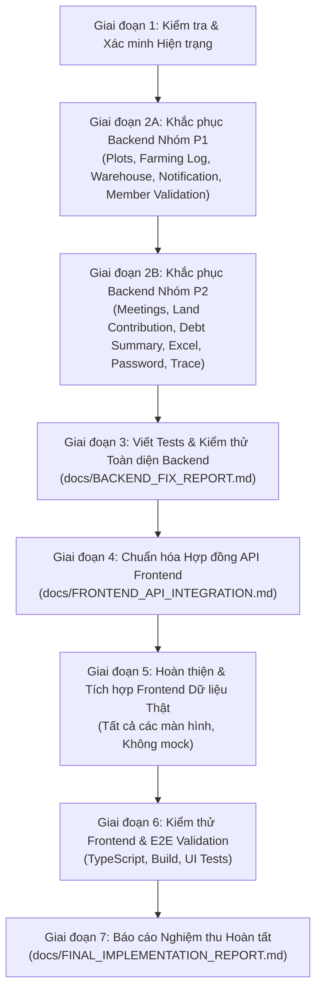

# KẾ HOẠCH TRIỂN KHAI TỔNG THỂ (MASTER IMPLEMENTATION PLAN)
## KHẮC PHỤC BACKEND, XÁC MINH API VÀ TRIỂN KHAI FRONTEND HOÀN CHỈNH CHO DỰ ÁN HTX-OCOP

> **Dự án:** Nền tảng Chuyển đổi số Quản trị Hợp tác xã Nông nghiệp & Số hóa Hồ sơ OCOP (HTX-OCOP Platform)  
> **Kiến trúc:** Laravel 11 Modular Monolith (Backend) + React 19 / TypeScript / Vite / TailwindCSS (Frontend)  
> **Chuyên viên chịu trách nhiệm:** Senior Software Engineer, Laravel Backend Architect, Senior Frontend Engineer & QA Lead  
> **Thời điểm lập kế hoạch:** 29/10/2026  
> **Mục tiêu tối thượng:** Khắc phục triệt để các khoảng trống API backend (P1, P2), bảo vệ bằng 100% Feature Tests, chuẩn hóa tài liệu hợp đồng tích hợp, và hoàn thiện toàn bộ giao diện Frontend kết nối dữ liệu thật.

---

## 1. KẾT QUẢ ĐỐI CHIẾU THỰC TẾ & CẬP NHẬT HIỆN TRẠNG (GIAI ĐOẠN 1)

Qua khảo sát thực tế mã nguồn và đối chiếu với hai tài liệu `docs/BACKEND_AUDIT_REPORT.md` và `docs/BACKEND_API_GAP_ANALYSIS.md`:

1. **Backend Codebase:**
   - 10 Modules Domain-Driven Design tại `backend/app/Modules/` đang vận hành hoàn toàn ổn định.
   - Cơ sở dữ liệu: PostgreSQL 16 với 72 migrations và 68 bảng đã migrate thành công.
   - Bộ kiểm thử tự động hiện tại: **186 tests, 1.033 assertions đang chạy PASS 100%** trong thời gian 8.53 giây.
   - An ninh & Đa người thuê: Middleware `EnforceTenantScope` và ma trận phân quyền SoD đã được chứng minh an toàn.
2. **Frontend Codebase:**
   - Framework: React 18/19, TypeScript, Vite 5, TailwindCSS, React Query (@tanstack/react-query), Zustand, React Router v6.
   - Cấu trúc thư mục: Module hóa theo `features/` (agriculture, auth, dashboard, finance, inventory, members, ocop, system).
   - Đã biên dịch thử nghiệm: `tsc && vite build` thành công 100% không có lỗi type.
   - Đã xử lý phân hệ Xã viên (`MemberDrawer` 5 tabs, `MemberEditModal` 4 sections form) sạch bóng mock data.
3. **Phân loại vấn đề cần khắc phục trước khi tích hợp sâu:**
   - **Nhóm P1 (Ảnh hưởng trực tiếp Frontend):**
     - P1-01: Thiếu `GET /api/v1/farm-plots` (danh sách phẳng thửa đất toàn HTX).
     - P1-02: Thiếu `GET /api/v1/members/{memberId}/plots` (thửa đất gán theo xã viên).
     - P1-03: Thiếu `DELETE /api/v1/farming-logs/{id}` (xóa nhật ký canh tác ghi sai).
     - P1-04: Thiếu CRUD kho đa điểm `/api/v1/warehouses` (đã có migration `000026`).
     - P1-05: Thiếu chuẩn hóa `NotificationController` sang `ApiResponse::success(...)` và bổ sung test.
     - P1-06: Thiếu validation chi tiết cho các trường JSON lồng nhau trong `UpdateMemberRequest.php`.
   - **Nhóm P2 (Nghiệp vụ bổ trợ theo SRS):**
     - P2-01: Thiếu Controller/Routes cho Đại hội thành viên & Biểu quyết (`meetings`, `votes`).
     - P2-02: Thiếu Controller/Routes cho Góp vốn bằng quyền sử dụng đất (`land_contributions`).
     - P2-03: Thiếu endpoint Báo cáo tổng hợp công nợ đa chiều (`GET /api/v1/finance/debts/summary`).
     - P2-04: Thiếu API kết xuất Excel server-side định dạng `.xlsx` OpenXML chuẩn.
     - P2-05: Thiếu API tự đổi mật khẩu cá nhân `POST /api/v1/auth/change-password`.
     - P2-06: Thiếu API truy vết lịch sử xã viên `GET /api/v1/audit-logs/trace/member/{id}`.
   - **Phân hệ Cho vay nội bộ (Tín dụng nội bộ HTX):**
     - Xác nhận: Thuộc Giai đoạn mở rộng (Option Phase 3 backlog) theo Luật HTX 2023. Không mở rộng database tùy tiện trong giai đoạn này.

---

## 2. KẾ HOẠCH THỰC THI CHI TIẾT THEO CÁC GIAI ĐOẠN

### GIAI ĐOẠN 2 — KHẮC PHỤC BACKEND

#### Sprint 2A: Giải quyết dứt điểm Nhóm P1
1. **P1-01: Bổ sung API Danh sách phẳng Thửa đất (`GET /api/v1/farm-plots`):**
   - File sửa: `app/Modules/Agriculture/Application/Services/FarmPlotService.php`, `app/Modules/Agriculture/Presentation/Http/Controllers/FarmPlotController.php`, `routes/api.php`.
   - Tính năng: Phân trang, lọc theo `status`, `member_id`, `production_unit_id`, `search` (mã thửa), tự động ràng buộc `cooperative_id` của tenant.
2. **P1-02: Bổ sung API Thửa đất theo Xã viên (`GET /api/v1/members/{memberId}/plots`):**
   - File sửa: `FarmPlotService.php`, `routes/api.php`.
   - Tính năng: Trả về danh sách thửa đất mà xã viên được phân công canh tác hoặc sở hữu.
3. **P1-03: Bổ sung API Xóa Nhật ký Canh tác (`DELETE /api/v1/farming-logs/{id}`):**
   - File sửa: `app/Modules/Agriculture/Application/Services/FarmingLogService.php`, `app/Modules/Agriculture/Presentation/Http/Controllers/FarmingLogController.php`, `routes/api.php`.
   - Quy tắc nghiệp vụ: Chỉ cho phép xóa khi vụ mùa chưa đóng (`status !== 'CLOSED'`), lô đất chưa có thu hoạch liên quan; kiểm tra quyền và ghi audit log `FARMING_LOG_DELETED`.
4. **P1-04: Xây dựng Module Quản lý Kho Đa điểm (`/api/v1/warehouses`):**
   - Files tạo mới:
     - Model: `app/Modules/Inventory/Infrastructure/Persistence/Models/WarehouseModel.php`
     - Service: `app/Modules/Inventory/Application/Services/WarehouseService.php`
     - Controller: `app/Modules/Inventory/Presentation/Http/Controllers/WarehouseController.php`
     - Requests: `CreateWarehouseRequest.php`, `UpdateWarehouseRequest.php`
     - Resource: `WarehouseResource.php`
   - File sửa: `routes/api.php`.
   - Quy tắc nghiệp vụ: Ràng buộc tenant `cooperative_id`, unique `warehouse_code`, chặn xóa nếu kho đang có phiếu nhập/xuất kho.
5. **P1-05: Chuẩn hóa Phân hệ Thông báo (`NotificationController`):**
   - File sửa: `app/Modules/Notification/Presentation/Http/Controllers/NotificationController.php`, `routes/api.php`.
   - Chuẩn hóa: Dùng `ApiResponse::success(...)`, bổ sung `POST /api/v1/notifications/mark-all-read`.
6. **P1-06: Hoàn thiện Validation Cập nhật Xã viên:**
   - File sửa: `app/Modules/Cooperative/Presentation/Http/Requests/UpdateMemberRequest.php`.
   - Bổ sung validation rules chi tiết cho `emergency_contact` (`name`, `phone`, `relationship`) và `bank_account_info` (`bank_name`, `account_number`, `account_holder`), hỗ trợ cập nhật linh hoạt không làm mất dữ liệu cũ.

#### Sprint 2B: Triển khai Nhóm P2
1. **P2-01: Phân hệ Đại hội Thành viên & Biểu quyết Nghị quyết:**
   - Tận dụng migration `000009_create_meetings_table` và `000010_create_votes_table`.
   - Files tạo mới: `MeetingModel`, `VoteModel`, `MeetingService`, `MeetingController`, Requests, Resources, Routes.
   - Nghiệp vụ: Lập cuộc họp, danh sách nghị quyết, bỏ phiếu (FOR, AGAINST, ABSTAIN), chống bỏ phiếu trùng qua unique constraint.
2. **P2-02: Phân hệ Góp vốn Quyền sử dụng Đất:**
   - Tận dụng migration `000064` và `LandContributionModel`.
   - Files tạo mới: `LandContributionService`, `LandContributionController`, Requests, Resource, Routes lồng theo member `/api/v1/members/{memberId}/land-contributions`.
3. **P2-03: Báo cáo Tổng hợp Công nợ Đa chiều:**
   - File sửa: `ReceivablePayableController.php`, `ReceivablePayableService.php`.
   - Endpoint: `GET /api/v1/finance/debts/summary` trả về: Tổng phải thu, Tổng phải trả, Phân loại tuổi nợ (dưới 30 ngày, 30-60 ngày, quá 90 ngày).
4. **P2-04: Dịch vụ Kết xuất Báo cáo Excel Server-side (.xlsx OpenXML chuẩn):**
   - File tạo mới: `app/Shared/Infrastructure/Export/OpenXmlSpreadsheetService.php` sử dụng native PHP `ZipArchive` & `XMLWriter` để tạo file Excel `.xlsx` chuẩn xác 100%, có tiêu đề bảng, định dạng cột và dữ liệu đầy đủ.
   - Endpoints: `GET /api/v1/reports/export/cash-book`, `GET /api/v1/reports/export/members`.
5. **P2-05: API Tự Đổi Mật khẩu Cá nhân:**
   - File sửa: `AuthController.php`, `routes/api.php`, Request `ChangePasswordRequest.php`.
   - Endpoint: `POST /api/v1/auth/change-password` (kiểm tra mật khẩu cũ, hash bcrypt mật khẩu mới, thu hồi token khác, ghi audit log an toàn).
6. **P2-06: Truy vết Lịch sử Xã viên:**
   - File sửa: `AuditLogController.php`, `AuditQueryService.php`.
   - Endpoint: `GET /api/v1/audit-logs/trace/member/{id}`.

---

### GIAI ĐOẠN 3 — KIỂM THỬ BACKEND (TDD & REGRESSION)

1. Viết các bộ Feature Tests mới:
   - `Tests\Feature\Agriculture\FarmPlotExtendedTest.php`: Kiểm tra `GET /farm-plots`, `GET /members/{id}/plots`, bộ lọc, phân trang, tenant scope.
   - `Tests\Feature\Agriculture\FarmingLogDeletionTest.php`: Kiểm tra xóa nhật ký thành công, chặn xóa khi vụ mùa đóng, audit log.
   - `Tests\Feature\Inventory\WarehouseManagementTest.php`: Kiểm tra CRUD kho, chặn xóa kho có ràng buộc phiếu nhập/xuất, tenant isolation.
   - `Tests\Feature\Notification\NotificationApiTest.php`: Kiểm tra lấy danh sách, mark read, mark all read, response chuẩn.
   - `Tests\Feature\Cooperative\MeetingAndVotingTest.php`: Kiểm tra tạo cuộc họp, biểu quyết, chặn bỏ phiếu trùng.
   - `Tests\Feature\Cooperative\LandContributionTest.php`: Kiểm tra CRUD góp đất, tính diện tích và giá trị.
   - `Tests\Feature\Identity\ChangePasswordTest.php`: Kiểm tra đổi mật khẩu, mật khẩu cũ sai, audit log.
2. Chạy toàn bộ test suite (`php artisan test`) đảm bảo:
   - Tối thiểu 195+ test cases.
   - 100% PASS, 0 failure, 0 error.
   - Không suy giảm bất kỳ bài test cũ nào.
3. Xuất tài liệu: `docs/BACKEND_FIX_REPORT.md`.

---

### GIAI ĐOẠN 4 — CHUẨN HÓA HỢP ĐỒNG API CHO FRONTEND

1. Kiểm kê danh mục route sau khi mở rộng.
2. Lập tài liệu `docs/FRONTEND_API_INTEGRATION.md` với đầy đủ:
   - HTTP method, endpoint, query params, body schema, response json mẫu, HTTP status codes, error handling.

---

### GIAI ĐOẠN 5 & 6 — TRIỂN KHAI HOÀN THIỆN & TÍCH HỢP FRONTEND

1. **Chuẩn hóa API Service Layer phía Frontend:**
   - Bổ sung `warehouseApi.ts`, `meetingApi.ts`, `landContributionApi.ts`, `changePasswordApi.ts`.
   - Mở rộng `farmPlotApi.ts` với `getAllPlots` và `getPlotsByMember`.
   - Mở rộng `farmingLogApi.ts` với `deleteFarmingLog`.
2. **Triển khai & Kiểm tra các màn hình nghiệp vụ:**
   - **Xã viên:** Tab "Đất canh tác" trong `MemberDrawer` kết nối API thật; tab "Vốn góp" hỗ trợ xem góp đất; form sửa xã viên lưu đầy đủ 19 trường.
   - **Canh tác:** Dropdown chọn thửa đất phẳng từ `/farm-plots`; nút xóa nhật ký canh tác mở modal xác nhận và gọi API xóa thật; PHI guard hiển thị cảnh báo thời gian cách ly.
   - **Kho vật tư:** Màn hình quản lý danh sách kho (`WarehousesPage` hoặc tab Kho trong `MaterialsPage`) kết nối CRUD kho thật.
   - **Thông báo:** Header Notification popup kết nối API thật, hỗ trợ xem và đánh dấu đã đọc.
   - **Tài khoản:** Modal Đổi mật khẩu trong Header / Settings kết nối `POST /auth/change-password`.
   - **Tài chính & OCOP:** Kết nối các báo cáo tổng hợp công nợ và xuất dữ liệu.
3. **Kiểm tra chất lượng Frontend:**
   - Chạy `npm run build` (`tsc && vite build`) đảm bảo 0 lỗi type.
   - Chạy kiểm tra E2E/Playwright hoặc script verification.

---

### GIAI ĐOẠN 7 — BÁO CÁO NGHIỆM THU TỔNG THỂ

1. Tạo file `docs/FINAL_IMPLEMENTATION_REPORT.md` tổng kết toàn diện 10 mục nghiệm thu theo yêu cầu.
2. Bàn giao hệ thống hoàn chỉnh.
