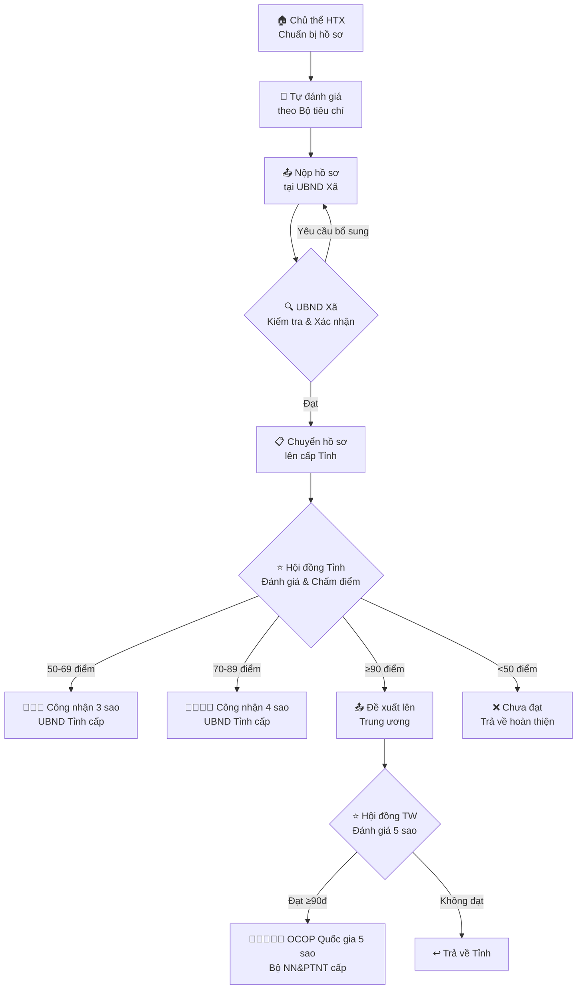
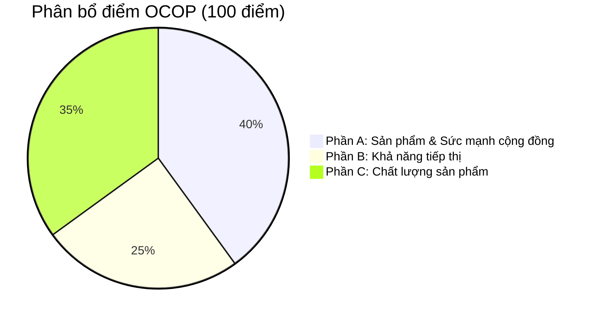
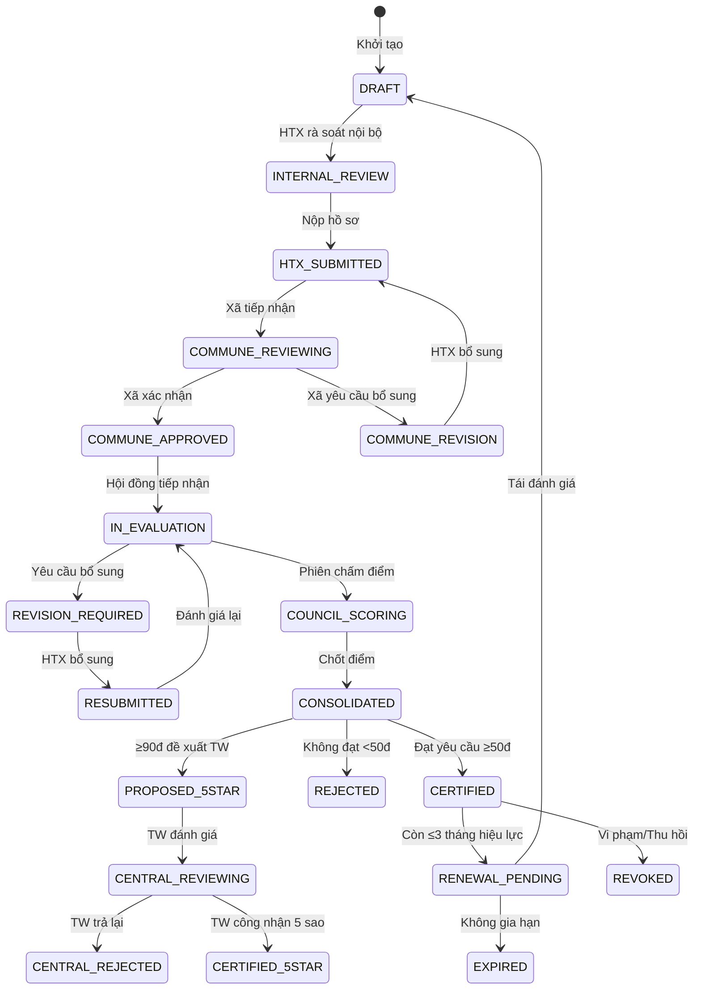
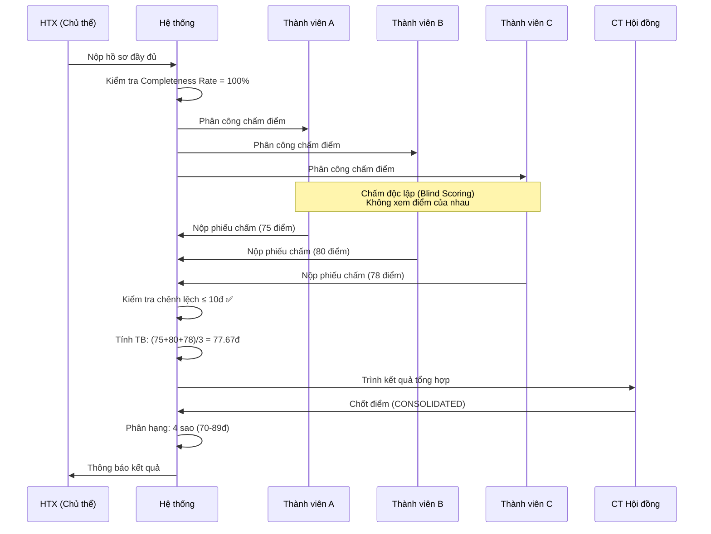
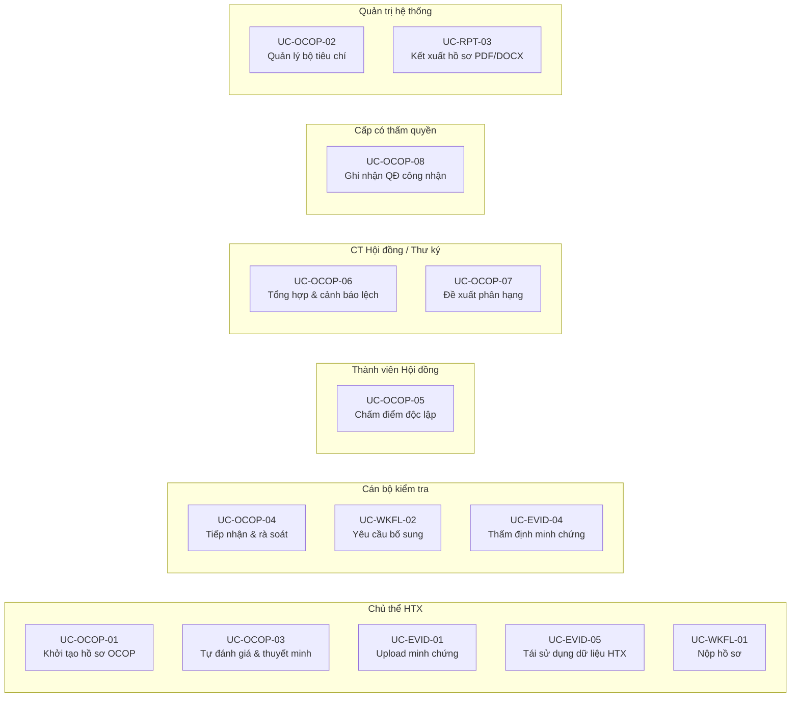
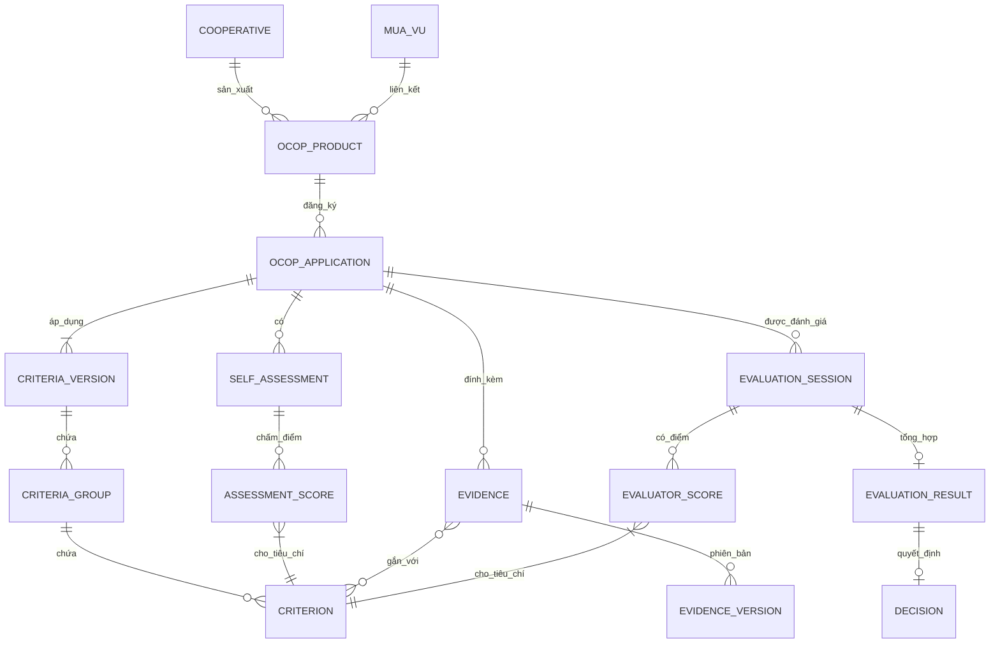
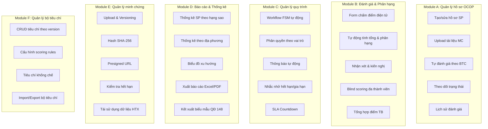

# KẾ HOẠCH CHI TIẾT XÂY DỰNG HỆ THỐNG ĐÁNH GIÁ, PHÂN HẠNG SẢN PHẨM OCOP

> **Dự án:** Hệ thống Quản trị HTX Nông nghiệp & Số hóa Hồ sơ Đánh giá Phân hạng OCOP
> **Căn cứ pháp lý:** Quyết định số 148/QĐ-TTg ngày 24/02/2023 của Thủ tướng Chính phủ
> **Đối tượng áp dụng:** HTX Dịch vụ Nông nghiệp Tổng hợp Tân Tiến
> **Sản phẩm mục tiêu:** Ớt chuông Sweet Palermo Đỏ Đà Lạt (mục tiêu 4-5 sao)

---

## MỤC LỤC

1. [Tổng quan Chương trình OCOP](#1-tổng-quan-chương-trình-ocop)
2. [Quy trình OCOP hoạt động ra sao](#2-quy-trình-ocop-hoạt-động-ra-sao)
3. [Cần phải chuẩn bị những gì](#3-cần-phải-chuẩn-bị-những-gì)
4. [Bộ tiêu chí đánh giá OCOP (Thang điểm 100)](#4-bộ-tiêu-chí-đánh-giá-ocop-thang-điểm-100)
5. [Phân hạng sao OCOP](#5-phân-hạng-sao-ocop)
6. [Workflow hệ thống](#6-workflow-hệ-thống)
7. [Biểu mẫu OCOP theo QĐ 148](#7-biểu-mẫu-ocop-theo-qđ-148)
8. [Các trường hợp xảy ra (Edge Cases)](#8-các-trường-hợp-xảy-ra-edge-cases)
9. [Use Cases hệ thống](#9-use-cases-hệ-thống)
10. [Tập luật kinh doanh (Business Rules)](#10-tập-luật-kinh-doanh-business-rules)
11. [Thiết kế dữ liệu](#11-thiết-kế-dữ-liệu)
12. [Module hệ thống cần xây dựng](#12-module-hệ-thống-cần-xây-dựng)
13. [Phân quyền RBAC](#13-phân-quyền-rbac)
14. [Audit & Traceability](#14-audit--traceability)
15. [Kết luận & Lộ trình](#15-kết-luận--lộ-trình)

---

## 1. TỔNG QUAN CHƯƠNG TRÌNH OCOP

### 1.1. OCOP là gì?

**OCOP** (*One Commune One Product* – Mỗi xã một sản phẩm) là chương trình phát triển kinh tế khu vực nông thôn theo hướng phát triển nội lực và gia tăng giá trị. Chương trình hỗ trợ các chủ thể sản xuất (HTX, doanh nghiệp, hộ kinh doanh) nâng cao chất lượng sản phẩm, mở rộng thị trường tiêu thụ thông qua cơ chế đánh giá và phân hạng sao.

### 1.2. Căn cứ pháp lý

| Văn bản | Nội dung |
|---------|----------|
| **QĐ 919/QĐ-TTg** (01/08/2022) | Phê duyệt Chương trình OCOP giai đoạn 2021-2025 |
| **QĐ 148/QĐ-TTg** (24/02/2023) | Ban hành Bộ tiêu chí và quy trình đánh giá, phân hạng sản phẩm OCOP |
| **QĐ 1489/QĐ-TTg** (06/07/2025) | Sửa đổi, bổ sung QĐ 148 (tinh giản cấp đánh giá) |

### 1.3. 6 nhóm sản phẩm OCOP

| TT | Nhóm sản phẩm | Ví dụ |
|----|---------------|-------|
| 1 | **Thực phẩm** | Nông, thủy sản tươi sống/sơ chế/chế biến |
| 2 | **Đồ uống** | Đồ uống có cồn, không cồn |
| 3 | **Thảo dược** | Thực phẩm chức năng, thuốc dược liệu, tinh dầu |
| 4 | **Vải và may mặc** | Sản phẩm từ bông, sợi, vải |
| 5 | **Lưu niệm - Nội thất - Trang trí** | Gỗ, mây tre, gốm sứ, dệt may |
| 6 | **Dịch vụ du lịch cộng đồng** | Du lịch sinh thái, điểm du lịch |

> [!NOTE]
> Sản phẩm Ớt chuông Sweet Palermo thuộc **Nhóm 1 - Thực phẩm** (Phân nhóm: Nông sản tươi sống).

---

## 2. QUY TRÌNH OCOP HOẠT ĐỘNG RA SAO

### 2.1. Sơ đồ quy trình tổng thể



### 2.2. Quy trình chi tiết từng bước

#### **Bước 1: Chủ thể chuẩn bị hồ sơ**

| Hoạt động | Chi tiết |
|-----------|----------|
| Xác định sản phẩm | Chọn sản phẩm tham gia đánh giá OCOP |
| Chọn bộ tiêu chí | Xác định bộ tiêu chí áp dụng theo nhóm sản phẩm |
| Thu thập minh chứng | Giấy tờ pháp lý, ảnh sản phẩm, kết quả kiểm nghiệm |
| Điền biểu mẫu | **Biểu số 01** (Phiếu đăng ký) + **Biểu số 02** (Báo cáo tự đánh giá) |
| Tự chấm điểm | Chấm điểm từng tiêu chí, đính kèm minh chứng tương ứng |

#### **Bước 2: Nộp hồ sơ tại UBND cấp Xã**

- Chủ thể nộp hồ sơ trực tiếp, qua bưu điện hoặc trực tuyến.
- Hồ sơ bao gồm: Phiếu đăng ký (Mẫu 01), Báo cáo tự đánh giá (Mẫu 02), toàn bộ tài liệu minh chứng.

#### **Bước 3: UBND Xã xác nhận (Biểu số 03)**

UBND cấp xã kiểm tra và xác nhận các nội dung:

| Nội dung xác nhận | Mô tả |
|-------------------|-------|
| Nguyên liệu địa phương | Mô tả và đánh giá tình hình sử dụng nguyên liệu thực tế trên địa bàn xã |
| Lao động địa phương | Đánh giá về tình hình sử dụng lao động địa phương |
| Nguồn gốc ý tưởng sản phẩm | Nhận xét sản phẩm truyền thống hay sản phẩm mới |
| Bản sắc/trí tuệ địa phương | Đánh giá về giá trị văn hóa, truyền thống thể hiện trên sản phẩm |

> **Output:** Biểu số 03 – Báo cáo đánh giá của UBND cấp xã, có ký tên và đóng dấu.

#### **Bước 4: Đánh giá cấp Tỉnh**

- Hội đồng cấp tỉnh tiếp nhận hồ sơ.
- Tổ chức thẩm định, đánh giá lại toàn bộ theo Bộ tiêu chí.
- **Thành phần Hội đồng cấp tỉnh:**
  - Chủ tịch: Phó Chủ tịch UBND cấp tỉnh
  - Phó Chủ tịch: Giám đốc (Phó GĐ) Sở NN&PTNT
  - Thành viên: Đại diện các sở, ban, ngành liên quan, chuyên gia
  - Tổ giúp việc: Cán bộ Sở NN&PTNT, Chi cục PTNT

#### **Bước 5: Đánh giá cấp Trung ương (nếu ≥90 điểm)**

- Bộ NN&PTNT thành lập Hội đồng đánh giá cấp Trung ương.
- Sản phẩm đạt ≥90 điểm: Công nhận **OCOP 5 sao** (cấp Quốc gia).
- **Thành phần Hội đồng cấp TW:**
  - Chủ tịch: Thứ trưởng Bộ NN&PTNT
  - Phó Chủ tịch: Cục trưởng/Phó Cục trưởng Cục KT hợp tác và PTNT
  - Thành viên: Đại diện các Bộ, ngành, chuyên gia, nhà khoa học

### 2.3. Thời hạn & Gia hạn

| Nội dung | Chi tiết |
|----------|----------|
| **Hiệu lực chứng nhận** | **36 tháng** (3 năm) kể từ ngày cấp |
| **Nhắc nhở tái đánh giá** | Trước khi hết hạn **6 tháng** (90 ngày trong hệ thống) |
| **Hết hạn** | Tự động thu hồi nếu không đăng ký đánh giá lại |
| **Nâng hạng** | 3⭐ → 4⭐ → 5⭐, quy trình tương tự đánh giá lần đầu |

---

## 3. CẦN PHẢI CHUẨN BỊ NHỮNG GÌ

### 3.1. Hồ sơ sản phẩm OCOP (Checklist đầy đủ)

| TT | Tài liệu | Bắt buộc | Loại dữ liệu số hóa |
|----|----------|----------|---------------------|
| 1 | **Phiếu đăng ký** đánh giá, phân hạng (Biểu số 01) | ✅ | Form điện tử |
| 2 | **Báo cáo tự đánh giá** về sản phẩm (Biểu số 02) | ✅ | Form điện tử + File đính kèm |
| 3 | **Phương án/Kế hoạch kinh doanh** sản phẩm | ✅ | File đính kèm (PDF/DOC) |
| 4 | **Giấy đăng ký kinh doanh** (bản sao) | ✅ | File scan (PDF/IMG) |
| 5 | **Giấy chứng nhận ATTP** hoặc Bản cam kết ATTP | ✅ | File scan (PDF/IMG) |
| 6 | **Bản tự công bố sản phẩm** / Giấy xác nhận công bố | ✅ | File scan (PDF/IMG) |
| 7 | **Bảng tự đánh giá** sản phẩm theo Bộ tiêu chí OCOP | ✅ | Form điện tử (tính điểm tự động) |
| 8 | **Kết quả kiểm nghiệm** sản phẩm (phiếu thử nghiệm) | ✅ | File scan (PDF/IMG) |
| 9 | **Ảnh sản phẩm**, bao bì, nhãn mác, tem truy xuất | ✅ | Ảnh (JPG/PNG) |
| 10 | **Mô tả quy trình sản xuất** | ✅ | File đính kèm + Ảnh |
| 11 | **Câu chuyện sản phẩm** | ✅ | Rich text + Ảnh/Video |
| 12 | **Giấy xác nhận của UBND cấp xã** (Biểu số 03) | ✅ | File scan (PDF/IMG) |
| 13 | Chứng chỉ chất lượng (VietGAP, HACCP, ISO, GlobalGAP, Hữu cơ...) | ⚡ Nếu có | File scan (PDF/IMG) |
| 14 | Đăng ký sở hữu trí tuệ (nhãn hiệu, CDĐL...) | ⚡ Nếu có | File scan (PDF/IMG) |
| 15 | Hợp đồng liên kết sản xuất | ⚡ Nếu có | File scan (PDF/IMG) |
| 16 | Tài liệu, minh chứng khác | ⚡ Nếu có | File scan/đính kèm |

### 3.2. Lưu ý quan trọng khi chuẩn bị

> [!IMPORTANT]
> - Hồ sơ phải **đầy đủ, rõ ràng**, có minh chứng cụ thể.
> - Sản phẩm phải **có mặt trên thị trường** (đang được bán, tiêu thụ).
> - Các giấy tờ, chứng nhận phải **còn hiệu lực**.
> - Kết quả kiểm nghiệm phải do **phòng thí nghiệm được công nhận** cấp.
> - Ảnh sản phẩm **rõ nét**, thể hiện đầy đủ bao bì, nhãn mác, tem truy xuất nguồn gốc.

### 3.3. Áp dụng cho HTX Tân Tiến – Ớt chuông Sweet Palermo

| Tiêu chí | Nguồn dữ liệu trong hệ thống HTX | Ghi chú |
|----------|-----------------------------------|---------|
| Nguyên liệu địa phương (TC-A.1) | Module `VungTrong`, `ThuaDat` | 100% diện tích tại Đà Lạt/Lạc Dương |
| Lao động địa phương (TC-A.2) | Danh sách xã viên/nhân sự HTX | 165 hộ xã viên |
| Liên kết chuỗi (TC-A.3) | `PhieuThuMua`, Hợp đồng bao tiêu | 4.720 tấn rau/năm |
| Bao bì & Truy xuất (TC-B.1.2) | Module QR, `lot_id` | Mã QR truy xuất nguồn gốc |
| Dư lượng BVTV (TC-C.2.2) | `NhatKyPhunThuoc` | Tuân thủ PHI 100% |

---

## 4. BỘ TIÊU CHÍ ĐÁNH GIÁ OCOP (THANG ĐIỂM 100)

### 4.1. Cấu trúc tổng quan



### 4.2. Chi tiết Bộ tiêu chí

#### PHẦN A: SẢN PHẨM & SỨC MẠNH CỘNG ĐỒNG (40 điểm)

| Mã | Tiêu chí | Điểm tối đa | Cách chấm điểm |
|----|----------|:------------:|-----------------|
| **I** | **Tổ chức sản xuất** | **20** | |
| 1.1 | Tỷ lệ nguyên liệu địa phương (trong tỉnh) | 7 | 100% ĐP: 7đ · ≥50%: 5đ · <50%: 1đ · Không: 0đ |
| 1.2 | Vùng nguyên liệu tập trung, ổn định | 3 | Có QH rõ ràng: 3đ · Chưa ổn định: 1đ · Không: 0đ |
| 2.1 | Tỷ lệ lao động địa phương | 5 | 100%: 5đ · ≥50%: 3đ · <50%: 1đ · Không: 0đ |
| 3.1 | Áp dụng hệ thống QLCL (ISO, HACCP, GMP, VietGAP...) | 5 | ≥2 chứng nhận: 5đ · 1 CN: 3đ · Đang XD: 1đ · Không: 0đ |
| **II** | **Phát triển sản phẩm** | **10** | |
| 4.1 | Có kế hoạch/phương án kinh doanh cụ thể, khả thi | 5 | Đầy đủ, khả thi: 5đ · Sơ sài: 2đ · Không: 0đ |
| 5.1 | Ứng dụng KHCN, đổi mới sáng tạo trong sản xuất | 5 | Ứng dụng hiệu quả: 5đ · Có ứng dụng: 3đ · Không: 0đ |
| **III** | **Sức mạnh cộng đồng** | **10** | |
| 6.1 | Liên kết sản xuất (HTX, THT, DN liên kết hộ nông dân) | 5 | Chặt chẽ: 5đ · Có: 3đ · Lỏng lẻo: 1đ · Không: 0đ |
| 7.1 | Số lao động thường xuyên | 5 | >30 LĐ: 5đ · 10-30: 3đ · <10: 1đ |

#### PHẦN B: KHẢ NĂNG TIẾP THỊ (25 điểm)

| Mã | Tiêu chí | Điểm tối đa | Cách chấm điểm |
|----|----------|:------------:|-----------------|
| **IV** | **Tiếp thị** | **15** | |
| 8.1 | Chất lượng bao bì, thiết kế | 5 | Đẹp, chuyên nghiệp: 5đ · Khá: 3đ · TB: 1đ · Kém: 0đ |
| 9.1 | Ghi nhãn đầy đủ theo quy định (NĐ 43/2017) | 3 | Đầy đủ: 3đ · Thiếu 1-2: 1đ · Không đạt: 0đ |
| 10.1 | Đăng ký SHTT (nhãn hiệu, CDĐL, kiểu dáng CN) | 4 | Đã có GCN: 4đ · Đã nộp đơn: 2đ · Chưa: 0đ |
| 11.1 | Hoạt động quảng bá, marketing | 3 | Đa dạng, hiệu quả: 3đ · Hạn chế: 1đ · Không: 0đ |
| **V** | **Câu chuyện sản phẩm** | **10** | |
| 12.1 | Nội dung gắn bản sắc, văn hóa, truyền thống | 5 | Hấp dẫn, đặc sắc: 5đ · Chưa nổi bật: 3đ · Sơ sài: 1đ · Không: 0đ |
| 12.2 | Hình thức trình bày (video, hình ảnh, text) | 5 | Chuyên nghiệp, sáng tạo: 5đ · Khá: 3đ · TB: 1đ · Không: 0đ |

#### PHẦN C: CHẤT LƯỢNG SẢN PHẨM (35 điểm)

| Mã | Tiêu chí | Điểm tối đa | Cách chấm điểm |
|----|----------|:------------:|-----------------|
| **VI** | **Chỉ tiêu cảm quan, dinh dưỡng & tính độc đáo** | **15** | |
| 13.1 | Hình thức, màu sắc, mùi, vị | 5 | Hấp dẫn, đặc trưng: 5đ · Khá: 3đ · TB: 1đ |
| 14.1 | Giá trị dinh dưỡng/công dụng nổi bật | 5 | Nổi bật, có chứng minh: 5đ · Chưa rõ: 2đ · Không: 0đ |
| 15.1 | Sự khác biệt, đặc sắc so với SP cùng loại | 5 | Rất khác biệt: 5đ · Có khác biệt: 3đ · Ít/Không: 0đ |
| **VII** | **Tiêu chuẩn sản phẩm** | **20** | |
| 16.1 | SP đạt TCVN/QCVN hoặc tiêu chuẩn quốc tế | 10 | Đạt TC quốc tế: 10đ · TCVN/QCVN: 7đ · Tự công bố: 3đ · Chưa: 0đ |
| 17.1 | Thị trường tiêu thụ (nội địa, xuất khẩu) | 5 | Xuất khẩu: 5đ · Toàn quốc: 3đ · Trong tỉnh: 1đ · Chưa: 0đ |
| 18.1 | Tiềm năng/thực tế xuất khẩu | 5 | Đã XK: 5đ · Đang chuẩn bị: 3đ · Có tiềm năng: 1đ · Không: 0đ |

### 4.3. Thuật toán chấm điểm

Gọi $n$ là số thành viên Hội đồng, điểm tiêu chí $j$:

$$S_j = \frac{1}{n}\sum_{i=1}^{n} s_{i,j}$$

Tổng điểm:

$$S_{tổng} = \sum_{j \in A} S_j + \sum_{j \in B} S_j + \sum_{j \in C} S_j$$

---

## 5. PHÂN HẠNG SAO OCOP

| Hạng | Điểm | Ý nghĩa | Cấp công nhận |
|------|:-----:|---------|:-------------:|
| ⭐⭐⭐⭐⭐ **5 sao** | 90 – 100 | Sản phẩm OCOP cấp Quốc gia. Chất lượng cao, đáp ứng tiêu chuẩn quốc tế, có khả năng xuất khẩu. | Bộ NN&PTNT |
| ⭐⭐⭐⭐ **4 sao** | 70 – 89 | Sản phẩm đặc trưng vùng miền, chất lượng tốt, tiếp cận thị trường tốt, tiềm năng nâng lên 5 sao. | UBND Tỉnh |
| ⭐⭐⭐ **3 sao** | 50 – 69 | Sản phẩm đạt tiêu chuẩn, được quản lý tốt, có thương hiệu. | UBND Tỉnh |
| ❌ **Chưa đạt** | < 50 | Chưa đạt yêu cầu tối thiểu, cần hoàn thiện thêm. | — |

> [!WARNING]
> Ngoài điểm số, hệ thống cần hỗ trợ cấu hình **"điều kiện cứng"** (tiêu chí khống chế). Ví dụ: sản phẩm thực phẩm bắt buộc phải có VietGAP hoặc xử lý môi trường đạt chuẩn mới được xếp hạng 4 sao trở lên.

---

## 6. WORKFLOW HỆ THỐNG

### 6.1. State Machine – Vòng đời hồ sơ OCOP



### 6.2. Bảng trạng thái chi tiết

| Trạng thái | Mã | Mô tả | Ai thao tác |
|-----------|-----|-------|:-----------:|
| Nháp | `DRAFT` | Chủ thể đang soạn hồ sơ | HTX |
| Rà soát nội bộ | `INTERNAL_REVIEW` | HTX tự kiểm tra trước khi nộp | HTX |
| Đã nộp | `HTX_SUBMITTED` | Đã nộp chính thức | HTX |
| Xã đang xem xét | `COMMUNE_REVIEWING` | UBND xã kiểm tra | Xã |
| Xã yêu cầu bổ sung | `COMMUNE_REVISION` | Xã yêu cầu sửa đổi | Xã |
| Xã xác nhận | `COMMUNE_APPROVED` | Xã xác nhận, chuyển lên | Xã |
| Đang đánh giá | `IN_EVALUATION` | Hội đồng tiếp nhận | Hội đồng |
| Yêu cầu bổ sung | `REVISION_REQUIRED` | Hội đồng yêu cầu bổ sung | Hội đồng |
| Nộp lại | `RESUBMITTED` | HTX đã bổ sung | HTX |
| Phiên chấm điểm | `COUNCIL_SCORING` | Hội đồng đang chấm điểm | Hội đồng |
| Đã chốt điểm | `CONSOLIDATED` | Điểm được chốt bởi CT Hội đồng | CT Hội đồng |
| Được chứng nhận | `CERTIFIED` | Đạt yêu cầu, cấp chứng nhận | Cơ quan TQ |
| Bị từ chối | `REJECTED` | Không đạt | Hội đồng |
| Đề xuất 5 sao | `PROPOSED_5STAR` | Đề xuất lên TW | UBND Tỉnh |
| TW đang đánh giá | `CENTRAL_REVIEWING` | Hội đồng TW thẩm định | HĐ TW |
| 5 sao Quốc gia | `CERTIFIED_5STAR` | Công nhận OCOP 5 sao | Bộ NN&PTNT |
| TW trả lại | `CENTRAL_REJECTED` | TW trả lại | HĐ TW |
| Sắp hết hạn | `RENEWAL_PENDING` | Còn ≤ 3 tháng hiệu lực | Hệ thống |
| Hết hạn | `EXPIRED` | Hết hạn 36 tháng | Hệ thống |
| Bị thu hồi | `REVOKED` | Vi phạm, bị thu hồi | Cơ quan TQ |

### 6.3. Quy tắc khóa dữ liệu theo trạng thái

| Trạng thái | Core Data | Evidence | Scores |
|-----------|:---------:|:--------:|:------:|
| `DRAFT` | ✏️ Sửa được | ✏️ Sửa được | — |
| `INTERNAL_REVIEW` | ✏️ Sửa được | ✏️ Sửa được | — |
| `HTX_SUBMITTED` | 🔒 Khóa | 🔒 Khóa | — |
| `IN_EVALUATION` | 🔒 Khóa | 👀 Chỉ đọc | ✏️ Chấm điểm |
| `REVISION_REQUIRED` | ✏️ Mở có kiểm soát | ✏️ Bổ sung | — |
| `COUNCIL_SCORING` | 🔒 Khóa | 🔒 Khóa | ✏️ Chấm điểm |
| `CONSOLIDATED` | 🔒 Bất biến | 🔒 Bất biến | 🔒 Bất biến |
| `CERTIFIED` | 🔒 Bất biến | 🔒 Bất biến | 🔒 Bất biến |

### 6.4. Workflow đánh giá Hội đồng (Blind Scoring)



---

## 7. BIỂU MẪU OCOP THEO QĐ 148

### 7.1. Biểu số 01 – Phiếu đăng ký đánh giá, phân hạng

**Mục đích:** Chủ thể đăng ký tham gia đánh giá OCOP

| Mục | Nội dung cần điền |
|-----|-------------------|
| 1 | Tên đơn vị đăng ký |
| 2 | Họ tên người đại diện pháp lý, chức vụ |
| 3 | Địa chỉ liên hệ, điện thoại, email |
| 4 | Tên sản phẩm đăng ký |
| 5 | Nhóm sản phẩm (1 trong 6 nhóm) |
| 6 | Lần đăng ký: Lần đầu □ / Nâng hạng □ / Đánh giá lại □ |
| 7 | Tài liệu kèm theo: Báo cáo tự đánh giá + Sản phẩm mẫu |

> Phần dưới Biểu số 01 dành cho Cơ quan tiếp nhận cấp Huyện và cấp Tỉnh ghi nhận thông tin tiếp nhận (Phiếu số, ngày nhận, người tiếp nhận).

### 7.2. Biểu số 02 – Báo cáo tự đánh giá về sản phẩm

**Mục đích:** Chủ thể tự đánh giá sản phẩm của mình theo Bộ tiêu chí

| Phần | Nội dung |
|------|----------|
| **Phần I** | Thông tin chung: Tên chủ thể, loại hình tổ chức, giấy tờ pháp lý (ĐKKD, ATTP, SHTT, QLCL) |
| **Phần II** | Kết quả thực hiện phương án SXKD: Vùng nguyên liệu, công nghệ, thị trường, doanh thu |
| **Phần III** | Đánh giá kết quả theo Bộ tiêu chí: Tự chấm điểm từng tiêu chí + minh chứng kèm theo |
| **Phần IV** | Kế hoạch SXKD: Định hướng phát triển sản phẩm, tổ chức sản xuất, thị trường |

### 7.3. Biểu số 03 – Báo cáo đánh giá của UBND cấp Xã

**Mục đích:** UBND xã xác nhận các thông tin thực tế tại địa phương

| Mục đánh giá | Nội dung |
|-------------|----------|
| 1. Nguyên liệu ĐP | Mô tả và đánh giá tình hình sử dụng nguyên liệu thực tế trên địa bàn xã |
| 2. Lao động ĐP | Đánh giá tình hình sử dụng lao động địa phương |
| 3. Nguồn gốc ý tưởng | Nhận xét sản phẩm truyền thống hay sản phẩm mới |
| 4. Bản sắc/trí tuệ ĐP | Đánh giá giá trị văn hóa, truyền thống thể hiện trên sản phẩm |

### 7.4. Phiếu đánh giá Hội đồng (Form chấm điểm)

**Mục đích:** Hội đồng chấm điểm từng tiêu chí

Bao gồm:
- Thông tin sản phẩm, chủ thể, nhóm SP
- Cấp đánh giá (Tỉnh / Trung ương)
- Bảng chấm điểm chi tiết 18 tiêu chí theo 3 phần A, B, C
- Tổng hợp kết quả + Xếp hạng sao
- Nhận xét chung + Kiến nghị
- Chữ ký CT Hội đồng và các Thành viên

---

## 8. CÁC TRƯỜNG HỢP XẢY RA (EDGE CASES)

### 8.1. Kịch bản 1: Hồ sơ chưa đủ nhưng nộp

| Tình huống | HTX mới tải minh chứng cho 15/22 tiêu chí (68%) nhưng bấm nút "Nộp hồ sơ" |
|------------|-------------|
| **Xử lý** | Hệ thống tính Completion Rate: $CR = \frac{\text{Số TC bắt buộc đã có MC}}{\text{Tổng số TC bắt buộc}} \times 100\%$ |
| **Kết quả** | Nếu $CR < 100\%$ → **Khóa nút nộp**, hiển thị danh sách tiêu chí còn thiếu |

### 8.2. Kịch bản 2: Minh chứng hết hạn trong lúc thẩm định

| Tình huống | Giấy VietGAP còn hạn 15 ngày khi nộp, nhưng hết hạn trước khi HĐ họp |
|------------|-------------|
| **Xử lý** | Job kiểm tra hàng đêm: Nếu $T_{thẩm\_định} > ngay\_het\_han$ → đổi trạng thái minh chứng sang `HET_HIEU_LUC` |
| **Kết quả** | Gửi cảnh báo đỏ cho HTX, tạm dừng chấm tiêu chí liên quan, yêu cầu tải lên giấy mới trong 15 ngày |

### 8.3. Kịch bản 3: Chênh lệch điểm quá lớn giữa HTX tự chấm và HĐ

| Tình huống | HTX tự chấm TC-A.4 = 15/15đ, nhưng HĐ chỉ chấm 6/15đ |
|------------|-------------|
| **Xử lý** | Nếu $|DiemTuCham - DiemHoiDong| \geq 5.0$ → phát cờ `HIGH_SCORE_DISCREPANCY` |
| **Kết quả** | Bắt buộc thành viên HĐ nhập lý do trừ điểm, hiển thị cho HTX xem |

### 8.4. Kịch bản 4: Chênh lệch điểm giữa các thành viên HĐ > 10đ

| Tình huống | Thành viên A chấm 65đ, Thành viên B chấm 80đ (chênh 15đ > 10đ) |
|------------|-------------|
| **Xử lý** | Hệ thống phát cảnh báo `VARIANCE_EXCEEDED`, yêu cầu họp HĐ phân giải |
| **Kết quả** | Không cho phép chốt điểm cho đến khi các thành viên đạt đồng thuận (chênh lệch ≤ 10đ) |

### 8.5. Kịch bản 5: Quá hạn bổ sung hồ sơ (SLA Deadline)

| Tình huống | HĐ yêu cầu bổ sung, HTX có 15 ngày làm việc |
|------------|-------------|
| **Xử lý** | Kích hoạt SLA Countdown, gửi nhắc nhở hàng ngày |
| **Kết quả** | Sau 15 ngày không cập nhật → Tự động chuyển trạng thái `HUY_HO_SO_QUA_HAN` |

### 8.6. Kịch bản 6: Nhắc nhở tái đánh giá 36 tháng

| Tình huống | Chứng nhận OCOP sắp hết hạn |
|------------|-------------|
| **Xử lý** | $T_{het\_han} = T_{cap} + 36\ tháng$. Trước 90 ngày → Gợi ý tái đánh giá |
| **Kết quả** | Tạo hồ sơ mới kế thừa dữ liệu cũ, trạng thái cũ chuyển `RENEWAL_PENDING` → `EXPIRED` |

### 8.7. Kịch bản 7: Thu hồi chứng nhận

| Tình huống | Chủ thể vi phạm ATTP, gian lận hồ sơ, hoặc không duy trì chất lượng |
|------------|-------------|
| **Xử lý** | Cơ quan có thẩm quyền ra quyết định thu hồi |
| **Kết quả** | Trạng thái → `REVOKED`, ghi nhận lý do + số hiệu quyết định thu hồi |

### 8.8. Kịch bản 8: Khiếu nại kết quả

| Tình huống | Chủ thể không đồng ý với kết quả đánh giá |
|------------|-------------|
| **Xử lý** | Chủ thể khiếu nại trong **15 ngày** kể từ ngày công bố kết quả |
| **Kết quả** | HĐ giải quyết trong **30 ngày**. Nếu không đồng ý → khiếu nại lên cấp trên |

---

## 9. USE CASES HỆ THỐNG

### 9.1. Sơ đồ Use Case tổng quan



### 9.2. Danh sách Use Case chi tiết

| UC ID | Tên Use Case | Actor chính | Mô tả |
|-------|-------------|:-----------:|-------|
| **UC-OCOP-01** | Khởi tạo hồ sơ OCOP | HTX | Chọn sản phẩm, chọn bộ tiêu chí (CriteriaVersion), tạo hồ sơ `DRAFT` |
| **UC-OCOP-02** | Quản lý bộ tiêu chí | Admin | Quản lý phiên bản, thêm/sửa tiêu chí, cấu hình điểm tối đa, tiêu chí bắt buộc |
| **UC-OCOP-03** | Tự đánh giá & thuyết minh | HTX | Chấm điểm từng tiêu chí, nhập giải trình, gắn minh chứng |
| **UC-OCOP-04** | Tiếp nhận & rà soát | Cán bộ KT | Kiểm tra hồ sơ theo checklist, xác nhận hoặc yêu cầu bổ sung |
| **UC-OCOP-05** | Chấm điểm độc lập | Evaluator | Blind scoring – chấm điểm không xem điểm người khác |
| **UC-OCOP-06** | Tổng hợp điểm & cảnh báo | Thư ký HĐ | Tính trung bình, kiểm tra chênh lệch > 10đ, cảnh báo |
| **UC-OCOP-07** | Đề xuất phân hạng | CT Hội đồng | Xác định hạng sao dựa trên điểm + điều kiện khống chế |
| **UC-OCOP-08** | Ghi nhận QĐ công nhận | Cơ quan TQ | Nhập số hiệu QĐ, ngày cấp, hạng chính thức |
| **UC-EVID-01** | Upload minh chứng | HTX | Tải lên file, nhập metadata, gắn với tiêu chí |
| **UC-EVID-02** | Ánh xạ minh chứng-tiêu chí | HTX | Liên kết nhiều-nhiều giữa minh chứng và chỉ tiêu |
| **UC-EVID-03** | Versioning minh chứng | HTX | Thay thế file cũ, tạo version mới, giữ lại lịch sử |
| **UC-EVID-04** | Thẩm định minh chứng | Cán bộ KT | Verify hoặc Reject minh chứng |
| **UC-EVID-05** | Tái sử dụng dữ liệu HTX | HTX | Trích xuất dữ liệu từ modules VungTrong, NhatKy... làm minh chứng |
| **UC-WKFL-01** | Nộp hồ sơ | HTX | Kiểm tra completeness, chuyển trạng thái `SUBMITTED` |
| **UC-WKFL-02** | Yêu cầu bổ sung | Cán bộ KT | Tạo revision request, đặt deadline |
| **UC-WKFL-03** | Khóa/mở khóa dữ liệu | Hệ thống | Tự động khóa/mở theo trạng thái workflow |
| **UC-RPT-03** | Kết xuất hồ sơ OCOP | HTX/Admin | Sinh PDF/DOCX theo biểu mẫu QĐ 148 |
| **UC-AUD-01** | Truy vết chuỗi dữ liệu | Admin | Truy vết: Kết quả → HĐ → Tiêu chí → Minh chứng → Dữ liệu canh tác |

---

## 10. TẬP LUẬT KINH DOANH (BUSINESS RULES)

| Rule ID | Nội dung | Mức độ |
|---------|----------|:------:|
| **BR-OCOP-01** | Hồ sơ không thể chuyển `HTX_SUBMITTED` nếu có tiêu chí bắt buộc thiếu minh chứng hoặc chưa tự chấm điểm (Completeness Check) | 🔴 Critical |
| **BR-OCOP-02** | Trong `COUNCIL_SCORING`, chênh lệch điểm tổng giữa các thành viên HĐ ≤ 10 điểm (Variance Check) | 🔴 Critical |
| **BR-OCOP-03** | Không ai được thay đổi điểm sau khi trạng thái = `CONSOLIDATED` (Immutability) | 🔴 Critical |
| **BR-OCOP-04** | Điểm không vượt quá điểm tối đa của tiêu chí | 🟡 High |
| **BR-OCOP-05** | Hồ sơ phải gắn với một phiên bản bộ tiêu chí cụ thể | 🟡 High |
| **BR-OCOP-06** | Minh chứng có thể có nhiều phiên bản, không xóa bản cũ | 🟡 High |
| **BR-OCOP-07** | Lịch sử hồ sơ phải truy vết được đầy đủ | 🟡 High |
| **BR-OCOP-08** | Tiêu chí khống chế/bắt buộc phải được kiểm tra trước khi xếp hạng | 🔴 Critical |
| **BR-OCOP-09** | Hạng đề xuất (Proposed) khác kết quả cuối cùng (Final Result) – cần QĐ của cấp TQ | 🟡 High |
| **BR-OCOP-10** | Hệ thống KHÔNG tự sửa điểm của người đánh giá. Bất thường → Flag → Notify → Human Review | 🔴 Critical |
| **BR-OCOP-11** | Giấy chứng nhận OCOP có hiệu lực 36 tháng | 🟡 High |
| **BR-OCOP-12** | Trước hết hạn 90 ngày → Nhắc nhở tái đánh giá | 🟢 Medium |
| **BR-OCOP-13** | Minh chứng có thời hạn → Job kiểm tra hàng đêm → Cảnh báo nếu hết hạn | 🟡 High |
| **BR-OCOP-14** | Hash SHA-256 file minh chứng khi upload → Đảm bảo toàn vẹn dữ liệu | 🟡 High |

---

## 11. THIẾT KẾ DỮ LIỆU

### 11.1. Mô hình quan hệ tổng quan



### 11.2. Các bảng dữ liệu chính

| Bảng | Mô tả | Cột chính |
|------|-------|-----------|
| `ocop_products` | Sản phẩm OCOP | `product_id`, `cooperative_id`, `product_name`, `product_group`, `current_star_rating`, `current_score`, `status`, `certification_date`, `expiry_date` |
| `ocop_applications` | Hồ sơ đăng ký | `application_id`, `product_id`, `application_type` (mới/gia hạn/nâng hạng), `status`, `current_level`, `criteria_version_id`, `self_assessment_score`, `submitted_at` |
| `ocop_criteria_versions` | Phiên bản bộ tiêu chí | `version_id`, `version_name`, `effective_from`, `effective_to`, `total_max_score` |
| `ocop_criteria` | Tiêu chí đánh giá | `criteria_id`, `version_id`, `section` (A/B/C), `criteria_code`, `criteria_name`, `max_score`, `scoring_guide`, `is_mandatory`, `sort_order` |
| `ocop_documents` | Tài liệu hồ sơ | `document_id`, `application_id`, `document_type`, `file_url`, `file_hash_sha256`, `version`, `status`, `expiry_date` |
| `ocop_self_assessments` | Tự đánh giá | `assessment_id`, `application_id`, `criteria_id`, `score`, `justification`, `evidence_ids` |
| `ocop_evaluations` | Đánh giá Hội đồng | `evaluation_id`, `application_id`, `evaluator_id`, `criteria_id`, `score`, `comment`, `adjustment_reason` |
| `ocop_evaluation_results` | Kết quả tổng hợp | `result_id`, `application_id`, `total_score`, `proposed_star_rating`, `final_star_rating`, `decision_number`, `decision_date` |

---

## 12. MODULE HỆ THỐNG CẦN XÂY DỰNG

### 12.1. Tổng quan module



### 12.2. Kết xuất tài liệu (Output Documents)

Hệ thống phải hỗ trợ kết xuất PDF/Word theo đúng biểu mẫu QĐ 148:

| Biểu mẫu | Tên | Nơi sử dụng |
|-----------|-----|:-----------:|
| Biểu số 01 | Phiếu đăng ký đánh giá, phân hạng SP OCOP | HTX nộp |
| Biểu số 02 | Báo cáo tự đánh giá về sản phẩm | HTX nộp |
| Biểu số 03 | Báo cáo đánh giá của UBND cấp xã | Xã xác nhận |
| Phiếu chấm điểm | Bảng chấm điểm chi tiết Hội đồng | Hội đồng |
| Bảng tổng hợp | Bảng tổng hợp điểm của Hội đồng | Hội đồng |
| QĐ công nhận | Quyết định cấp Giấy chứng nhận OCOP | Cơ quan TQ |

---

## 13. PHÂN QUYỀN RBAC

| Vai trò | Mã quyền | Mô tả |
|---------|----------|-------|
| **Giám đốc / Nhân viên HTX** | `OCOP.MANAGE`, `OCOP.SUBMIT` | Tạo, sửa hồ sơ; nộp hồ sơ chính thức |
| **Thành viên Hội đồng** (Evaluator) | `OCOP.SCORE` | Chấm điểm độc lập (blind), KHÔNG được sửa nội dung hồ sơ HTX |
| **Chủ tịch Hội đồng** | `OCOP.CONSOLIDATE` | Chốt điểm, phê duyệt tổng hợp |
| **Thư ký Hội đồng** | `OCOP.SECRETARY` | Tổng hợp hồ sơ, phiếu chấm, biên bản |
| **Cán bộ kiểm tra** | `OCOP.REVIEW` | Kiểm tra hồ sơ, yêu cầu bổ sung |
| **Cấp có thẩm quyền** | `OCOP.DECIDE` | Ghi nhận quyết định công nhận |
| **Admin bộ tiêu chí** | `OCOP.CRITERIA_ADMIN` | Quản lý phiên bản tiêu chí |
| **Xã viên** | `OCOP.READ_OWN` | Chỉ xem hồ sơ liên quan đến SP mình đóng góp |

> [!CAUTION]
> **Nguyên tắc Separation of Duties (SoD):** Người tạo/nộp hồ sơ KHÔNG được là người chấm điểm hoặc phê duyệt cùng hồ sơ đó.

---

## 14. AUDIT & TRACEABILITY

### 14.1. Chuỗi truy vết

```text
Quyết định Công nhận
    ↓
Kết quả Đánh giá (Điểm TB + Hạng sao)
    ↓
Phiếu chấm Hội đồng (Điểm từng thành viên)
    ↓
Tiêu chí / Chỉ tiêu (Mã, phiên bản, điểm tối đa)
    ↓
Minh chứng (File, hash, version)
    ↓
Phiên bản Minh chứng (v1.0 → v2.0)
    ↓
Dữ liệu gốc (VungTrong, NhatKy, PhieuThuMua...)
```

### 14.2. Các sự kiện audit bắt buộc

| Event Type | Trigger |
|-----------|---------|
| `OCOP_APPLICATION_CREATED` | Tạo hồ sơ mới |
| `OCOP_APPLICATION_UPDATED` | Cập nhật hồ sơ |
| `OCOP_SUBMITTED` | Nộp hồ sơ |
| `OCOP_REVISION_REQUESTED` | Yêu cầu bổ sung |
| `OCOP_RESUBMITTED` | Nộp lại hồ sơ |
| `EVIDENCE_UPLOADED` | Upload minh chứng |
| `EVIDENCE_REPLACED` | Thay thế minh chứng |
| `EVIDENCE_VERIFIED` | Xác nhận minh chứng |
| `EVIDENCE_REJECTED` | Từ chối minh chứng |
| `OCOP_SCORE_RECORDED` | Thành viên HĐ chấm điểm |
| `OCOP_SCORE_CONSOLIDATED` | Chốt điểm HĐ |
| `OCOP_CERTIFIED` | Cấp chứng nhận |
| `OCOP_REJECTED` | Từ chối hồ sơ |
| `OCOP_EXPIRED` | Hết hạn chứng nhận |
| `OCOP_REVOKED` | Thu hồi chứng nhận |
| `DOCUMENT_EXPORTED` | Kết xuất tài liệu |

### 14.3. Cấu trúc bản ghi audit

```json
{
  "event_type": "OCOP_SCORE_RECORDED",
  "entity_type": "OcopApplication",
  "entity_id": "APP-2026-001",
  "from_state": "IN_EVALUATION",
  "to_state": "COUNCIL_SCORING",
  "action": "record_score",
  "actor_id": "USER-123",
  "actor_role": "OCOP_AUDITOR",
  "timestamp": "2026-10-02T08:30:00Z",
  "reason": "Chấm điểm tiêu chí TC-A.1",
  "metadata": {
    "criteria_id": "TC-A.1",
    "score": 10.0,
    "max_score": 10.0
  }
}
```

---

## 15. KẾT LUẬN & LỘ TRÌNH

### 15.1. Tóm tắt

Hệ thống số hóa OCOP cần đảm bảo:

1. ✅ Tuân thủ đúng quy trình theo **QĐ 148/QĐ-TTg**
2. ✅ Số hóa **100% hồ sơ**, giấy tờ, biểu mẫu
3. ✅ Tự động hóa **workflow đánh giá đa cấp** (Xã → Tỉnh → TW)
4. ✅ Hỗ trợ **chấm điểm điện tử** với Bộ tiêu chí đầy đủ 18 tiêu chí
5. ✅ **Blind scoring** – chấm điểm độc lập, bảo mật giữa các thành viên HĐ
6. ✅ Quản lý **vòng đời sản phẩm OCOP** (36 tháng, tái đánh giá, nâng hạng)
7. ✅ Tích hợp **thông báo, nhắc nhở** tự động
8. ✅ **Truy vết** toàn bộ chuỗi: Kết quả → Điểm → Tiêu chí → Minh chứng → Dữ liệu gốc
9. ✅ **Không hard-code** tiêu chí, ngưỡng sao – mọi thứ cấu hình qua database
10. ✅ Tích hợp với **dữ liệu sản xuất** của HTX (VungTrong, NhatKy, PhieuThuMua...)

### 15.2. Liên kết chuỗi nghiệp vụ xuyên suốt

```text
Xã viên → Vốn góp → Vùng trồng → Mùa vụ → Nhật ký canh tác → Thu hoạch/Lô SP
    → Sản phẩm thương mại → Hồ sơ OCOP → Tự đánh giá → Minh chứng
    → Hội đồng chấm điểm → Tổng hợp → Phân hạng sao → Chứng nhận
    → Tái đánh giá (36 tháng)
```

### 15.3. Nguyên tắc thiết kế then chốt

> [!IMPORTANT]
> 1. **Versioning tiêu chí:** Mỗi hồ sơ gắn cứng với 1 phiên bản bộ tiêu chí.
> 2. **No Hard-coding:** Tiêu chí, điểm, ngưỡng sao lưu trong DB, không trong source code.
> 3. **Immutability:** Thay đổi bộ tiêu chí → Tạo version mới, KHÔNG ảnh hưởng hồ sơ cũ.
> 4. **Audit Trail:** Mọi thay đổi đều được ghi log, không xóa lịch sử.
> 5. **Separation of Duties:** Người nộp ≠ Người chấm ≠ Người phê duyệt.

---

> **Tài liệu tham chiếu:**
> - [Biểu mẫu 1](file:///f:/HTX_OCOP_PROJECT/docs/Bieu%20m%E1%BA%ABu%201%20mau-phieu-dk-danh-gia-phan-han-sp-OCOP.docx) – Phiếu đăng ký đánh giá OCOP
> - [Biểu mẫu 2](file:///f:/HTX_OCOP_PROJECT/docs/Bieu%20m%E1%BA%ABu%202.docx) – Báo cáo tự đánh giá
> - [Biểu số 03](file:///f:/HTX_OCOP_PROJECT/docs/BIEU%20SO%2003-PHU%20LUC%20II-QD-148-QD-TTg.docx) – Báo cáo đánh giá UBND xã
> - [Thông tin cách đánh giá OCOP](file:///f:/HTX_OCOP_PROJECT/docs/Thong-tin-ve-cach-danh-gia-OCOP-148-ttg.signed.pdf) – Hướng dẫn đánh giá theo QĐ 148
> - [04_OCOP_BUSINESS.md](file:///f:/HTX_OCOP_PROJECT/docs/04_OCOP_BUSINESS.md) – Đặc tả nghiệp vụ OCOP
> - [34_OCOP_WORKFLOW.md](file:///f:/HTX_OCOP_PROJECT/docs/34_OCOP_WORKFLOW.md) – Quy trình workflow OCOP
> - [16_WORKFLOW_SPECIFICATION.md](file:///f:/HTX_OCOP_PROJECT/docs/16_WORKFLOW_SPECIFICATION.md) – Đặc tả workflow chi tiết
> - [09_USE_CASES_FINAL.md](file:///f:/HTX_OCOP_PROJECT/docs/09_USE_CASES_FINAL.md) – Use Cases hệ thống
